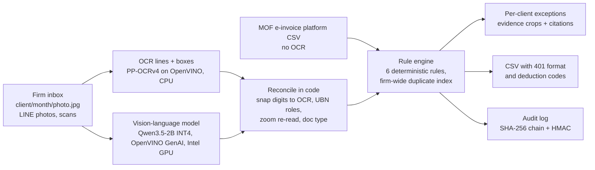

# Ledger Room

**An on-premises receipt audit box for Taiwanese bookkeeping firms (記帳業者).** The firm drops each client's receipts
and uniform invoices (統一發票) into `client/month/` folders on one office machine. OCR and a small vision-language model
(Qwen3.5-2B INT4 on OpenVINO, Intel GPU) read every document. Deterministic code then checks Unified Business Number
(統一編號, UBN) checksums under the 2023 rule, duplicates within a client and across clients, VAT Act Art. 19
non-deductible items, client expense limits and filing periods. The bookkeeper gets a per-client exception list with
evidence crops, law citations, a CSV with the 401 format and deduction codes, and an HMAC-chained audit log, and
nothing leaves the office network. On the held-out synthetic set, first blind run, Ledger Room scored micro F1 0.96;
the same model auditing on its own scored 0.15 (details under [Results](#results)).

Entry for the ASUS UGen AI League (Thunderstorm track, Workplace AI), Stage I. Every number here was measured on a
laptop (Intel Core i7-13620H, Intel UHD iGPU). No Arc Pro B70 has been used yet.

> **All data in this repository is SYNTHETIC.** Every company, Unified Business Number (統一編號, UBN), invoice
> number, amount and document image is generated by code (`synth/generate.py`, drawn with Pillow). No real people,
> no real business records, no AI-generated images. Any match with a real business is coincidental.

## Why a bookkeeping firm needs this

- Taiwan has about 8,600 bookkeeping firms, and the Ministry of Finance inspects their personal-data safeguards
  every year (703 firms in 2025) ([news, 2025-11-26](https://www.ctee.com.tw/news/20251126701522-430104)).
- The bookkeepers' personal-data safeguard regulation
  ([記帳士與記帳及報稅代理人個人資料檔案安全維護管理辦法](https://law.moj.gov.tw/LawClass/LawAll.aspx?pcode=G0340165))
  asks a firm to supervise outsourced processing (Art. 10), to check MOF restrictions and tell clients before any
  international transfer (Art. 11), to give staff different permissions (Art. 15), and to keep usage records and
  system trail data for at least five years (Art. 19). A firm whose systems hold 10,000 or more personal-data records
  must also have user identity checks, display masking, access control and monitoring of abnormal use (Art. 17).
  Sending client receipts to an overseas cloud model is exactly the kind of transfer that needs that paperwork. A
  local model avoids it, and the controls below map to Arts. 15, 17 and 19.
- The UBN check-digit rule changed in 2023 (divisible by 10 became divisible by 5), so older checking code wrongly
  rejects newly issued numbers ([MOF Fiscal Information Agency](https://www.fia.gov.tw/singlehtml/3?cntId=c4d9cff38c8642ef8872774ee9987283)).
- A firm sees all of its clients' vouchers. Only a firm-level system can notice the same receipt claimed by two
  different client companies.

## What it checks

The model only reads. Every decision below is made by code in `ledger_room/rules.py`, and each exception links to its source.

| Rule id | What it catches | Source |
|---|---|---|
| `UBN_CHECKSUM` | A seller or buyer UBN that fails the 2023 mod-5 rule (with the 7th-digit-is-7 case). Also explains when a number passes the new rule but would fail the old one. | [FIA notice](https://www.fia.gov.tw/singlehtml/3?cntId=c4d9cff38c8642ef8872774ee9987283) |
| `DUP_CROSS_MONTH` | The same voucher submitted again by the same client (same invoice number, or same seller + date + total) | With input tax for this client: [VAT Act Art. 51](https://law.moj.gov.tw/LawClass/LawSingle.aspx?pcode=G0340080&flno=51). Without (e.g. a taxi receipt): [Income Tax Act Art. 24](https://law.moj.gov.tw/LawClass/LawSingle.aspx?pcode=G0340003&flno=24) and [Audit Regulations Art. 67](https://law.moj.gov.tw/LawClass/LawSingle.aspx?pcode=G0340051&flno=67) |
| `DUP_CROSS_CLIENT` | The same voucher filed under two different clients | As above, plus [VAT Act Art. 33](https://law.moj.gov.tw/LawClass/LawSingle.aspx?pcode=G0340080&flno=33) when input tax is claimed |
| `S19_NONDEDUCTIBLE` | Input tax claimed on entertainment or gifts, employee personal benefits, a passenger car for own use, or non-business items | [VAT Act Art. 19](https://law.moj.gov.tw/LawClass/LawSingle.aspx?pcode=G0340080&flno=19) |
| `OVER_LIMIT` | A document above the client's own expense policy (meal, taxi, lodging, approval threshold) | client policy in `clients.json` |
| `PERIOD_MISMATCH` | A date after the filing period, or an e-invoice period header that does not contain its own date. A date **before** the period is only a warning: input tax may be claimed in a later period (from the second period on, with a stated reason, up to ten years) | [Art. 35](https://law.moj.gov.tw/LawClass/LawSingle.aspx?pcode=G0340080&flno=35), [Enforcement Rules Art. 29](https://law.moj.gov.tw/LawClass/LawSingle.aspx?pcode=G0340081&flno=29) |

Optional, off in the evaluation: `UBN_NOT_REGISTERED` (warning). With a local copy of the MOF business-registration
open data ([data.gov.tw dataset 9400](https://data.gov.tw/dataset/9400), set `LEDGER_REGISTRY` to the .zip or .csv),
a checksum failure one digit away from a registered business is reported as a likely misread, and a well-formed
number that is not registered gets a warning. `ledger_room/registry.py`; tested on a small fixture only, not yet on
the downloaded file.

## How it works

1. **Read.** OCR finds text lines, exact digits and their positions. The vision-language model sees the photo plus the
   OCR lines and returns the document as JSON (type, invoice number, date, seller and buyer, UBNs, items, totals, notes).
2. **Reconcile (code).** Model digits are snapped to the printed OCR digits when they differ by at most two places.
   UBN roles come from the words around each number (賣方 / 買方 / 買受人 / the red seller stamp), so a model that copies
   the seller's number into the buyer field is overruled. When the buyer UBN is printed in boxes that OCR misses, code
   crops the area next to the label, enlarges it and reads it again. Every field keeps its provenance
   (`ocr-confirmed`, `snapped`, `ocr-zoom`, `model-only`, ...).
3. **Check (code).** The six rules run across the whole firm at once, which is what makes cross-client duplicates visible.
4. **Show, export and log.** The web app lists exceptions per client with the evidence crop, the field provenance and
   the official citation. Each run also writes `export_401.csv`: one line per document with the 401 media-file format
   code (格式代號 21 / 22 / 25), the deduction code (扣抵代號 1, or 3 when Art. 19 applies; 2 and 4 for fixed assets are
   set by hand), the ROC date and a status (`READY`, `HOLD` until an exception is resolved, or `NOT_IN_401` for a
   voucher without input tax). It is a CSV for review and import mapping, not the fixed-width .TXT file itself, and it
   has not been imported into any accounting software yet. Every read and every exception goes into an append-only
   JSONL log (see [Access control and the audit log](#access-control-and-the-audit-log)).
5. **E-invoices without OCR.** Most input vouchers already exist on the MOF e-invoice platform. `ledger_room/einvoice.py`
   imports the platform's CSV export (UTF-8 or Big5, footnote lines skipped, line items grouped into invoices, discount
   and zero-price lines kept) and hands the invoices to the same rules. It is tested on a synthetic fixture and was run
   once on one person's own consumer e-invoices (aggregates under [Results](#results)); wiring it into the web inbox is
   Stage II work.

## Access control and the audit log

What is in place, and what it does not do:

- **Binds to 127.0.0.1.** Without user accounts the web app is a single local user and refuses any other address.
- **Accounts and roles** (regulation Arts. 15 and 17(1)(1)): `python -m web.users add NAME --role admin|staff` stores
  PBKDF2-SHA256 password hashes in `%LOCALAPPDATA%\LedgerRoom\users.json`. With accounts, every request except the
  sign-in page needs a session (8 hours, HttpOnly, SameSite=Strict); five wrong passwords lock that name for five
  minutes. Staff can read exceptions and documents, replay runs and export; only an admin can run the model live and
  read the logs. Only then may `--host 0.0.0.0` share it on the office LAN.
- **Operation log** (Arts. 17(1)(4), 17(1)(6) and 19): sign-ins, failed sign-ins, runs, result views, log views and
  exports are appended to `data/out/oplog.jsonl` with the user and IP address.
- **Tamper evidence, not tamper proof.** Each log entry carries the SHA-256 of the previous entry and an HMAC-SHA256
  under an operator key (`%LOCALAPPDATA%\LedgerRoom\audit.key`, created on first use, outside the data folder). The
  plain hash chain alone only shows accidental damage, because anyone who can write the disk can recompute it. The
  HMAC lets whoever holds the key detect an edited, inserted or removed entry (`tests/test_audit_log.py` forges a
  re-chained log and the HMAC catches it). It does not stop someone who holds both the disk and the key, so for real
  use the key belongs on a separate USB key or Windows account (`LEDGER_AUDIT_KEY_FILE`). Signing with a hardware key
  is Stage II work.
- **Not done:** display masking (Art. 17(1)(2)), encryption of the data folder, and network intrusion defence
  (Art. 17(1)(5)) are left to the firm's Windows and network setup today. Usage records must be kept five years
  (Art. 19); Ledger Room never deletes logs, but retention is the firm's backup policy.

## Model and runtime

| Part | Choice | License |
|---|---|---|
| Vision-language model | [OpenVINO/Qwen3.5-2B-int4-ov](https://huggingface.co/OpenVINO/Qwen3.5-2B-int4-ov) (Intel's pre-converted INT4 build of Qwen3.5-2B) | Apache-2.0 |
| Model runtime | OpenVINO GenAI 2026.4 `VLMPipeline`, device `GPU` (Intel GPU), falls back to `CPU` | Apache-2.0 |
| OCR | PP-OCRv4 det/rec models from the `rapidocr-onnxruntime` wheel, executed by OpenVINO | Apache-2.0 |

Why this path: it runs on the laptop's Intel UHD iGPU today through the same OpenVINO GPU plugin that drives Intel Arc,
and it follows the toolchain of ASUS's own Arc Pro B70 sample (OpenVINO + Qwen3.5 vision models). The measured
alternatives are in the results block below.

**Intel Arc Pro B70 path (planned, not measured).** No B70 was used for any number in this repository. What the
laptop shows (held-out set, see [Results](#results)): the 2B reader is fast enough even on the laptop iGPU, and after
OCR snapping it gets every identifier right, but it misreads amounts (net, tax), which a 401 export line needs. The
9B reader (`OpenVINO/Qwen3.5-9B-int4-ov`, same code, thinking mode off) roughly halves the key-field errors, but on the
laptop it only ran on the CPU (compiling it for the iGPU ran out of memory, since the iGPU shares system RAM), at more
than a minute per document. That is why the B70 is in the plan: 32 GB of dedicated memory holds the 9B (5.9 GB) or a
27B INT4 reader (16 GB) next to the KV cache, so the better reader can get through a firm's month in one night. The
code switches with `LEDGER_MODEL_DIR` and `LEDGER_DEVICE=GPU`.

Stage II targets on the B70, set now so they can be checked:

| Target | 9B INT4 reader | 27B INT4 reader |
|---|---|---|
| Key fields wrong, held-out | no worse than the laptop 9B plus 1 point | below the 9B |
| Ledger Room micro F1, held-out | at least 0.95 | at least 0.95 |
| Documents per hour, whole pipeline | at least 600; goal 1,200 (12,000 documents in one night) | at least 300 |
| Pure-model baseline with the same model | reported next to Ledger Room | reported next to Ledger Room |

**Offline.** The only step that needs the internet is the one-time model download. At run time nothing is sent out:
OCR, the model and the rules run in-process, and the web app loads no external scripts, fonts or images. OpenVINO's
optional telemetry package is installed as a dependency, but it is only used by the `ovc` model-conversion tool,
which Ledger Room does not call. Spot check on 2026-10-14: during a live run in the web app (model loading and
reading), the server process's TCP connections were sampled every 6 seconds for a minute; none went to a non-local
address. Stage II should repeat this with the network adapter disabled.

## Run it in five steps (Windows, Python 3.12)

1. **Install.** `python -m venv .venv` then `.venv\Scripts\python -m pip install -r requirements.txt`
2. **Download the model once** (about 2.1 GB, the only step that needs the internet):
   `.venv\Scripts\python -m ledger_room.get_model`
   It fetches [OpenVINO/Qwen3.5-2B-int4-ov](https://huggingface.co/OpenVINO/Qwen3.5-2B-int4-ov) into
   `E:\models\Qwen3.5-2B-int4-ov`. For another folder, set `LEDGER_MODEL_DIR` first, for example
   `$env:LEDGER_MODEL_DIR="C:\models\Qwen3.5-2B-int4-ov"` in PowerShell.
3. **Test.** `.venv\Scripts\python -m pytest -q` checks the rule engine, the UBN checksum, the frozen answer keys, and
   that every number in this README equals `eval/results.json`. No model needed.
4. **Audit offline.** Turn off Wi-Fi or unplug the cable, then
   `.venv\Scripts\python -m ledger_room.pipeline --set heldout`
   This reads all 47 held-out documents with the model (about 10 to 15 minutes on the laptop iGPU) and writes
   `data/out/runs/<run id>/` with `result.json`, evidence crops and `audit_log.jsonl`. Reads are cached in
   `data/out/cache`, so a second run with `--cache-only` replays them in seconds without loading the model.
   `--set main` runs the other inbox.
5. **Open the web app.** `.venv\Scripts\python -m web.server`, then browse to http://127.0.0.1:8780, pick the
   `heldout` inbox and press **Run live** (re-reads with the model) or, after a first run, **Replay batch** (cached reads).
   **Export CSV** downloads the 401-coded lines of the run shown. To share it on the office LAN, first add accounts
   (`.venv\Scripts\python -m web.users add amy --role admin`), then start it with `--host 0.0.0.0`; the documents still
   stay on this machine.

No Intel GPU? Set `LEDGER_DEVICE=CPU` (about 45 s per document on the laptop CPU). For the larger reader, download `--repo OpenVINO/Qwen3.5-9B-int4-ov --dir E:\models\Qwen3.5-9B-int4-ov` with the same `get_model` command and point `LEDGER_MODEL_DIR` at it. Other environment variables:
`LEDGER_MODEL_DIR` (model folder), `LEDGER_OCR_DEVICE` (default `CPU`), `LEDGER_VLM_MAX_SIDE` (default 896 px).

## Reproduce the evaluation

- **Full run (loads the model, roughly 50 minutes on the laptop).** `.venv\Scripts\python -m eval.run_eval`, then
  `.venv\Scripts\python -m eval.report`. This runs Ledger Room and the pure-model baseline on both sets, the oracle
  control and the positive control, and rewrites `eval/results.json`, `eval/RESULTS.md` and the results block below;
  `pytest` then confirms they agree.
- **Re-score only (seconds).** After a full run, `.venv\Scripts\python -m eval.run_eval --score-only` re-scores from
  the cached reads (`data/out/cache`) and pure-model answers (`data/out/baseline`). Delete those two folders to force
  fresh reads. Reads on the Intel GPU are not bit-identical between runs: in one repeat of the held-out set, two
  documents came back with different item lines or totals, while all 24 exceptions stayed the same.
- **Larger reader (held-out only, about 2 hours on the laptop CPU).**
  `.venv\Scripts\python -m eval.run_larger --model-dir E:\models\Qwen3.5-9B-int4-ov --device CPU` writes
  `eval/results_larger.json` (Ledger Room and the pure-model baseline with the 9B, reading accuracy, memory);
  `eval.measure_reader` records a reader's peak memory on a few documents; `run_eval --score-only` then merges both.
- **Real e-invoice check.** `.venv\Scripts\python -m eval.einvoice_check EXPORT.csv ... --out DIR` runs the import and
  the rules on MOF platform exports and writes aggregates only. Keep the exports and `DIR` outside the repository;
  `eval/results_einvoice_check.json` holds the aggregates of the one run reported here.
- The first blind held-out run is stored in `eval/results_blind_first_run.json`; `run_eval` merges it into
  `results.json` so the blind numbers are never overwritten by later runs.

## Synthetic data and evaluation

- `data/main`: 52 documents, 5 fictitious clients, layout family A. `data/heldout`: 47 documents, 5 other
  fictitious clients, layout family B (other fonts, column order, landscape receipts, rotation, uneven light).
  Both answer keys (`eval/expected_*.json`) were committed before any prompt or code tuning; tuning used `main` only.
- Planted issues per set: bad UBN checksums, re-submitted vouchers across months, one voucher under two clients,
  Art. 19 items, over-limit documents, wrong-period documents, plus clean documents. Some clean documents carry
  UBNs that pass the 2023 rule but fail the old one, to catch checkers that still use mod 10.
- **Planted rate.** 24 of the 52 main documents and 24 of the 47 held-out documents carry a planted issue, about
  half. Nobody knows that rate for real client folders; it is probably much lower, so precision and F1 on real data
  will differ from the numbers below.
- `eval/run_eval.py` compares Ledger Room with a **pure-model baseline**: the same model, same photo, same OCR lines,
  with the rules, the client's policy and the filing period in the prompt, plus a running list of the documents it
  already reviewed (built from its own answers). No code checks. `eval/run_larger.py` repeats both on the held-out
  set with a larger reader (Qwen3.5-9B), so the gap is not just a small-model effect.
- **Reading accuracy** (`eval/read_accuracy.py`): the fields Ledger Room ends up with, compared with the answer key,
  over eight key fields (type, invoice number, date, seller and buyer UBN, net, tax, total), plus whether every item
  line in the key was read.
- **Read time per document** means one thing everywhere (README, RESULTS.md, deck, video): OCR + model + zoomed
  re-reads for one document, averaged over a whole set. The held-out figure comes from the live run recorded for the
  video (screen capture was running on the same machine); its reads are the ones scored here.
- Controls: an **oracle** run (rules on the ground-truth fields, must be 100%) and a **positive control** (a clean
  batch, then the same batch with one planted change per issue type).
- Every number below is generated from `eval/results.json` by `python -m eval.report`; a test fails if they differ.

## Results

<!-- RESULTS:START (generated by eval/report.py from eval/results.json) -->
Synthetic data. Same local model (Qwen3.5-2B INT4, OpenVINO) on the same photo + OCR text in both columns; the pure model gets the rules in its prompt but no code checks.

| Set | Ledger Room micro F1 | Pure model micro F1 | Read time per document (laptop iGPU) |
|---|---|---|---|
| main (52 docs, layout A) | 1.00 (P 100%, R 100%) | 0.17 (P 10%, R 50%) | 16.7 s |
| heldout (47 docs, layout B) | 1.00 (P 100%, R 100%) | 0.15 (P 9%, R 42%) | 15.1 s |

**Held-out, first blind run** (code 5d02c9b, before any change made after seeing held-out errors): Ledger Room F1 0.96 (P 100%, R 92%), pure model F1 0.15. The table above uses later code with four fixes made after that run (listed in eval/RESULTS.md), so its held-out row is no longer blind.

**Does a bigger model alone close the gap?** Held-out set (frozen key, no tuning), same laptop, Qwen3.5-9B-int4-ov on CPU:

| Reader | Ledger Room F1 | Pure model F1 | Reading error rate (key fields wrong) | Docs with all item lines right | Read time per document |
|---|---|---|---|---|---|
| Qwen3.5-2B-int4-ov | 1.00 | 0.15 | 12% (39/331) | 19/47 | 15.1 s |
| Qwen3.5-9B-int4-ov | 1.00 | 0.17 | 6% (20/337) | 28/47 | 78.4 s |

Key fields: type, invoice number, date, seller and buyer UBN, net, tax, total. Thinking mode off for both. The 9B ran on the laptop CPU because compiling it for the iGPU ran out of memory (the iGPU shares system RAM). On disk: 2B 1.99 GB, 9B 5.85 GB. Peak RAM in use (working set, eval/measure_reader.py): 2B on the iGPU 3.9 GB, 9B on the CPU 11.6 GB. 9B on the laptop CPU: about 46 documents per hour.

**Real data, import path only (no OCR):** one person's own consumer e-invoices exported from the MOF platform (3 months; not a bookkeeping firm's client data; aggregates only). 30 invoices / 95 line items imported (7 with discount lines, 7 with zero-price lines). Seller UBNs passing the 2023 checksum: 23/23 (4 of them would fail an outdated mod-10 checker). Duplicates: 0. Art. 19 keyword hits: 2 invoices (alcohol); meal invoices: 12. Import plus rules: 0.085 ms per invoice.

Positive control: 7/7 planted changes detected, 0 false flags after, 0 flags before. Gate (stop if pure model >= 95% of Ledger Room): max ratio 0.17, pass. Details: [eval/RESULTS.md](eval/RESULTS.md).

Runtime choice, measured on 2026-10-14 (Intel Core i7-13620H laptop, Intel UHD Graphics (iGPU), 32 GB RAM; same triplicate-invoice test image):

| Configuration | Time per document | Used |
|---|---|---|
| Qwen3.5-2B INT4, OpenVINO GenAI, CPU, full-size image (1144x844) | 43-48 s | no |
| Qwen3.5-2B INT4, OpenVINO GenAI, Intel iGPU, full-size image | 22-28 s | no |
| Qwen3.5-2B INT4, OpenVINO GenAI, Intel iGPU, image max side 896 px | 14-16 s | yes |
| Same + built-in MTP speculative decoding (2 draft tokens) | 14.5 then 38 s | no |
| OCR: PP-OCRv4 det+rec .onnx via ONNX Runtime 1.31, CPU | 17-28 s | no |
| OCR: Same .onnx files compiled by OpenVINO 2026.4, CPU | 0.3-1.1 s | yes |
<!-- RESULTS:END -->

## Limits

- Synthetic photos only. Real phone photos sent over LINE, handwriting and faded thermal paper will be harder. The
  only real data so far is one person's own consumer e-invoices through the import path (no OCR, no photos).
- About half of the test documents carry a planted issue; real folders will have far fewer, so real precision will
  be lower.
- The 401 CSV follows the media-file fields but has not been imported into any accounting software; deduction codes
  2 and 4 (fixed assets) are left to the bookkeeper.
- The planted issue types were designed by the author. The held-out set changes seed, clients and layouts, not the
  definitions of the issues.
- Art. 19 categories are decided by an auditable keyword table first and by the model's suggested category only as a
  fallback (marked "medium" confidence). A real deployment needs the firm to review that table.
- Synthetic UBNs are random numbers that satisfy the checksum; the evaluation never loads the business register.
  The register lookup is tested on a small fixture only.
- Laptop timings use an Intel UHD iGPU. B70 performance is a plan until it is measured.

## Licenses

Code: MIT (see `LICENSE`). Model weights: Apache-2.0 (Qwen3.5, converted by OpenVINO). OCR models and RapidOCR:
Apache-2.0. Synthetic images are rendered with Noto Sans/Serif TC (SIL OFL) and Windows system fonts (DFKai-SB,
MingLiU); the images contain rendered text only, not font files.
