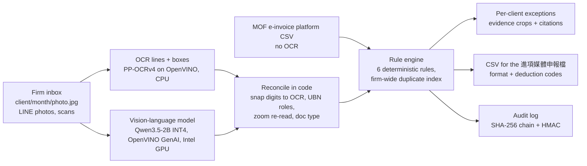

# Ledger Room

**An on-premises receipt audit box for Taiwanese bookkeeping firms (記帳業者).** The firm drops each client's receipts
and uniform invoices (統一發票) into `client/month/` folders on one office machine. OCR and a small vision-language model
(Qwen3.5-2B INT4 on OpenVINO, Intel GPU) read every document. Deterministic code then checks Unified Business Number
(統一編號, UBN) checksums under the 2023 rule, duplicates within a client and across clients, VAT Act Art. 19
non-deductible items, client expense limits and filing periods. The bookkeeper gets a per-client exception list with
evidence crops, law citations, the input records for the VAT media filing file (進項媒體申報檔) as a review CSV and as
the 81-character fixed-width file, and an HMAC-chained audit log, and nothing leaves the office network. On the held-out synthetic set, first blind run, Ledger Room scored micro F1 0.96;
the same model auditing on its own scored 0.15 (details under [Results](#results)).

Entry for the ASUS UGen AI League (Thunderstorm track, Workplace AI), Stage I. Every number here was measured on a
laptop (Intel Core i7-13620H, Intel UHD iGPU). No Arc Pro B70 has been used yet.

> **All data in this repository is SYNTHETIC.** Every company, Unified Business Number (統一編號, UBN), invoice
> number, amount and document image is generated by code (`synth/generate.py`, drawn with Pillow). No real people,
> no real business records, no AI-generated images. Any match with a real business is coincidental.

## Why a bookkeeping firm needs this

- Taiwan has about 8,600 bookkeeping firms, and the Ministry of Finance inspects their personal-data safeguards
  every year (703 firms in 2025) ([news, 2025-11-26](https://www.ctee.com.tw/news/20251126701522-430104)).
- The bookkeepers' personal-data safeguard regulation
  ([記帳士與記帳及報稅代理人個人資料檔案安全維護管理辦法](https://law.moj.gov.tw/LawClass/LawAll.aspx?pcode=G0340165))
  asks a firm to supervise outsourced processing (Art. 10), to check MOF restrictions and tell clients before any
  international transfer (Art. 11), to give staff different permissions (Art. 15), and to keep usage records and
  system trail data for at least five years (Art. 19). A firm whose systems hold 10,000 or more personal-data records
  must also have user identity checks, display masking, access control and monitoring of abnormal use (Art. 17).
  Sending client receipts to an overseas cloud model is exactly the kind of transfer that needs that paperwork. A
  local model avoids it, and the controls below map to Arts. 15, 17 and 19.
- The UBN check-digit rule changed in 2023 (divisible by 10 became divisible by 5), so older checking code wrongly
  rejects newly issued numbers ([MOF Fiscal Information Agency](https://www.fia.gov.tw/singlehtml/3?cntId=c4d9cff38c8642ef8872774ee9987283)).
- A firm sees all of its clients' vouchers. Only a firm-level system can notice the same receipt claimed by two
  different client companies.

## What it checks

The model only reads. Every decision below is made by code in `ledger_room/rules.py`, and each exception links to its source.

| Rule id | What it catches | Source |
|---|---|---|
| `UBN_CHECKSUM` | A seller or buyer UBN that fails the 2023 mod-5 rule (with the 7th-digit-is-7 case). Also explains when a number passes the new rule but would fail the old one. | [FIA notice](https://www.fia.gov.tw/singlehtml/3?cntId=c4d9cff38c8642ef8872774ee9987283) |
| `DUP_CROSS_MONTH` | The same voucher submitted again by the same client (same invoice number, or same seller + date + total) | With input tax for this client: deducting it twice may constitute over-claimed input tax (虛報進項稅額), [VAT Act Art. 51(1)(5)](https://law.moj.gov.tw/LawClass/LawSingle.aspx?pcode=G0340080&flno=51); the bookkeeper decides. Without (e.g. a taxi receipt): [Income Tax Act Art. 24](https://law.moj.gov.tw/LawClass/LawSingle.aspx?pcode=G0340003&flno=24) and [Audit Regulations Art. 67(1)](https://law.moj.gov.tw/LawClass/LawSingle.aspx?pcode=G0340051&flno=67) (an expense without an original voucher is in principle not recognised) |
| `DUP_CROSS_CLIENT` | The same voucher filed under two different clients | As above, plus [VAT Act Art. 33](https://law.moj.gov.tw/LawClass/LawSingle.aspx?pcode=G0340080&flno=33) when input tax is claimed |
| `S19_NONDEDUCTIBLE` | Input tax claimed on entertainment or gifts, employee personal benefits, a passenger car for own use, or non-business items | [VAT Act Art. 19](https://law.moj.gov.tw/LawClass/LawSingle.aspx?pcode=G0340080&flno=19) |
| `OVER_LIMIT` | A document above the client's own expense policy (meal, taxi, lodging, approval threshold) | client policy in `clients.json` |
| `PERIOD_MISMATCH` | A date after the filing period, or an e-invoice period header that does not contain its own date. A date **before** the period is only a warning: input tax may be claimed in a later period (from the second period on, with a stated reason, up to ten years) | [Art. 35](https://law.moj.gov.tw/LawClass/LawSingle.aspx?pcode=G0340080&flno=35), [Enforcement Rules Art. 29](https://law.moj.gov.tw/LawClass/LawSingle.aspx?pcode=G0340081&flno=29) |

Severities: a match on seller + date + amount without a shared invoice number is a **possible duplicate** (warning:
two same-day taxi rides at the same fare are normal); a shared invoice number is a duplicate (high). Art. 19 matches on
alcohol and meal words are **to confirm** (warning: a restaurant buys beer to resell); gifts, staff trips and passenger
cars stay findings. A payment slip or transaction detail is paired with any document of the same date and amount and
reported as a possible duplicate (a meal detail and its Line Pay slip are one purchase).

Routing rules, outside the six evaluated types (the answer keys were frozen before them), reported separately:

| Rule id | What it does | Source |
|---|---|---|
| `AMOUNT_MISMATCH` (hold) | net + tax must equal the total and tax must be 5% of net (NT$1 rounding); a voucher the client would deduct also needs both amounts read. Held until corrected. | arithmetic, 5% standard rate |
| `BUYER_NOT_CLIENT` | buyer UBN missing (consumer-style invoice: expense only) or another company's: no deductible input tax. A two-part invoice (二聯式) without the buyer's UBN is never deductible; a two-part cash-register invoice that carries this client's UBN is (format code 22, [Enforcement Rules Art. 38](https://law.moj.gov.tw/LawClass/LawSingle.aspx?pcode=G0340081&flno=38)) | [VAT Act Art. 19(1)(1)](https://law.moj.gov.tw/LawClass/LawSingle.aspx?pcode=G0340080&flno=19), [Art. 33](https://law.moj.gov.tw/LawClass/LawSingle.aspx?pcode=G0340080&flno=33) |
| `BUYER_PRESUMED` (hold) | buyer UBN unreadable but the buyer name looks like the client: never deducted on a guess | Art. 33 |
| `NOT_A_VOUCHER` (hold) | a payment slip or a transaction / order detail (printed keywords, traditional or simplified), or a slip with neither seller UBN nor invoice number: not a voucher on its own; ask the client for the invoice | [Audit Regulations Art. 67](https://law.moj.gov.tw/LawClass/LawSingle.aspx?pcode=G0340051&flno=67) |
| `SMALL_RECEIPT_CAP` (warning) | plain receipts (普通收據) from small businesses (printed 免用統一發票), cumulative per client, above 3% (千分之三十) of the year's manufacturing expenses plus operating expenses (`annual_manufacturing_expenses` + `annual_operating_expenses` in `clients.json`, ideally the amounts the tax office assesses); off unless both are set. Other receipts are not capped by this rule | [Audit Regulations Art. 67(3)](https://law.moj.gov.tw/LawClass/LawSingle.aspx?pcode=G0340051&flno=67) |

Deduction codes: the export sets 1 (deductible purchases and expenses) or 3 (non-deductible, Art. 19). Codes 2 and 4
(fixed assets) are not detected; the 記帳士 sets them.

Optional, off in the evaluation: `UBN_NOT_REGISTERED` (warning). With a local copy of the MOF business-registration
open data ([data.gov.tw dataset 9400](https://data.gov.tw/dataset/9400), set `LEDGER_REGISTRY` to the .zip or .csv),
a checksum failure one digit away from a registered business is reported as a likely misread, and a well-formed
number that is not registered gets a warning. `ledger_room/registry.py`; tested on a small fixture only, not yet on
the downloaded file.

## How it works

1. **Read.** OCR finds text lines, exact digits and their positions. The vision-language model sees the photo plus the
   OCR lines and returns the document as JSON (type, invoice number, date, seller and buyer, UBNs, items, totals, notes).
2. **Reconcile (code).** Model digits are snapped to the printed OCR digits when they differ by at most two places.
   UBN roles come from the words around each number (賣方 / 買方 / 買受人 / the red seller stamp), so a model that copies
   the seller's number into the buyer field is overruled. When the buyer UBN is printed in boxes that OCR misses, code
   crops the area next to the label, enlarges it and reads it again. The total, net and tax are picked by code from
   the printed rows (cash, change, balance and deposit lines never count); the model's own reading is one vote, and a
   total without two agreeing sources goes to a person. Every field keeps its provenance
   (`ocr-confirmed`, `snapped`, `ocr-zoom`, `model-only`, ...).
3. **Check (code).** The six rules run across the whole firm at once, which is what makes cross-client duplicates visible.
4. **Show, export and log.** The web app lists exceptions per client with the evidence crop, the field provenance and
   the official citation. Each run also writes `export_media.csv`: one line per document, laid out like the input records of the VAT media
   filing file (進項媒體申報檔), with the format code (格式代號 21 / 22 / 25), the deduction code (扣抵代號 1, or 3 when Art. 19 applies; 2 and 4 for fixed assets are
   set by hand), the ROC date and a status (`READY`, `HOLD` until an exception is resolved, or `NOT_IN_FILE` for a
   voucher without input tax). `python -m ledger_room.export` writes the fixed-width .TXT file from the `READY` lines
   (see [Stage II progress](#stage-ii-progress)); neither file has been imported into accounting software yet. Every read and every exception goes into an append-only
   JSONL log (see [Access control and the audit log](#access-control-and-the-audit-log)).
5. **E-invoices without OCR.** Most input vouchers already exist on the MOF e-invoice platform. `ledger_room/einvoice.py`
   imports the platform's CSV export (UTF-8 or Big5, footnote lines skipped, line items grouped into invoices, discount
   and zero-price lines kept) and hands the invoices to the same rules. It is tested on a synthetic fixture and was run
   once on one person's own consumer e-invoices (aggregates under [Results](#results)); wiring it into the web inbox is
   Stage II work.

## Access control and the audit log

What is in place, and what it does not do:

- **Binds to 127.0.0.1.** Without user accounts the web app is a single local user and refuses any other address.
- **Accounts and roles** (regulation Arts. 15 and 17(1)(1)): `python -m web.users add NAME --role admin|staff` stores
  PBKDF2-SHA256 password hashes in `%LOCALAPPDATA%\LedgerRoom\users.json`. With accounts, every request except the
  sign-in page needs a session (8 hours, HttpOnly, SameSite=Strict); five wrong passwords lock that name for five
  minutes. Staff can read exceptions and documents, replay runs and export; only an admin can run the model live and
  read the logs. Only then may `--host 0.0.0.0` share it on the office LAN.
- **Operation log** (Arts. 17(1)(4), 17(1)(6) and 19): sign-ins, failed sign-ins, runs, result views, log views and
  exports are appended to `data/out/oplog.jsonl` with the user and IP address.
- **Tamper evidence, not tamper proof.** Each log entry carries the SHA-256 of the previous entry and an HMAC-SHA256
  under an operator key (`%LOCALAPPDATA%\LedgerRoom\audit.key`, created on first use, outside the data folder). The
  plain hash chain alone only shows accidental damage, because anyone who can write the disk can recompute it. The
  HMAC lets whoever holds the key detect an edited, inserted or removed entry (`tests/test_audit_log.py` forges a
  re-chained log and the HMAC catches it). It does not stop someone who holds both the disk and the key, so for real
  use the key belongs on a separate USB key or Windows account (`LEDGER_AUDIT_KEY_FILE`). Signing with a hardware key
  is Stage II work.
- **Not done:** display masking (Art. 17(1)(2)), encryption of the data folder, and network intrusion defence
  (Art. 17(1)(5)) are left to the firm's Windows and network setup today. Usage records must be kept five years
  (Art. 19); Ledger Room never deletes logs, but retention is the firm's backup policy.

## Model and runtime

| Part | Choice | License |
|---|---|---|
| Vision-language model | [OpenVINO/Qwen3.5-2B-int4-ov](https://huggingface.co/OpenVINO/Qwen3.5-2B-int4-ov) (Intel's pre-converted INT4 build of Qwen3.5-2B) | Apache-2.0 |
| Model runtime | OpenVINO GenAI 2026.4 `VLMPipeline`, device `GPU` (Intel GPU), falls back to `CPU` | Apache-2.0 |
| OCR | PP-OCRv4 det/rec models from the `rapidocr-onnxruntime` wheel, executed by OpenVINO | Apache-2.0 |

Why this path: it runs on the laptop's Intel UHD iGPU today through the same OpenVINO GPU plugin that drives Intel Arc,
and it follows the toolchain of ASUS's own Arc Pro B70 sample (OpenVINO + Qwen3.5 vision models). The measured
alternatives are in the results block below.

**Intel Arc Pro B70 path (planned, not measured).** No B70 was used for any number in this repository. What the
laptop shows (see [Results](#results)): the 2B reader is fast enough even on the laptop iGPU, and since code picks
the amounts it ends with every key field right on the synthetic held-out set. Real photos are harder: on the 10 real
receipts the 2B still sends 6 of 15 captures to a person, the 9B (`OpenVINO/Qwen3.5-9B-int4-ov`, same code, thinking
mode off) 4 of 15. On the laptop the 9B only ran on the CPU (compiling it for the iGPU ran out of memory, since the
iGPU shares system RAM), at more than a minute per document. That is why the B70 is in the plan: 32 GB of dedicated memory holds the 9B (5.9 GB) or a
27B INT4 reader (about 15 GB) next to the KV cache, so the better reader can get through a firm's month in one night. The
code switches with `LEDGER_MODEL_DIR` and `LEDGER_DEVICE=GPU`.

Stage II targets on the B70, set now so they can be checked:

| Target | 9B INT4 reader | 27B INT4 reader |
|---|---|---|
| Key fields wrong, held-out | no worse than the laptop 9B plus 1 point | below the 9B |
| Ledger Room micro F1, held-out | at least 0.95 | at least 0.95 |
| Read time per document, whole pipeline (not yet verified) | pass 6 s, goal 3 s (600 / 1,200 per hour; goal: 12,000 documents in one night) | at most 12 s |
| Pure-model baseline with the same model | reported next to Ledger Room | reported next to Ledger Room |

**Offline.** The only step that needs the internet is the one-time model download. OCR, the model and the rules run
in-process, and the web app loads no external scripts, fonts or images.

An earlier version of this section said OpenVINO's telemetry was only used by the `ovc` model-conversion tool, which
Ledger Room never calls. That was wrong. `import openvino` imports `ovc` as well, and `ovc` sends one anonymous
"import" event to Google Analytics when the machine has no telemetry consent file. `eval/offline_check.py` caught it
on 2026-11-02 (a DNS lookup of www.google-analytics.com and one HTTPS connection; `eval/results_offline_before_fix.json`).
The event carries no document data. A spot check on 2026-10-14 had missed it because it sampled connections only
every 6 seconds.

The fix is in `ledger_room/__init__.py`: before any module imports OpenVINO, Ledger Room sets `CI=true` for its own
process. The telemetry package treats that as "declined" (`OptInChecker._run_in_ci` in
[openvinotoolkit/telemetry](https://github.com/openvinotoolkit/telemetry); `ovc` calls it with `disable_in_ci=True`).
OpenVINO's [documented switch](https://docs.openvino.ai/2026/about-openvino/additional-resources/telemetry.html),
`opt_in_out --opt_out`, writes a per-user setting instead; the host install scripts still run it, but Ledger Room
does not depend on it. `tests/test_telemetry_off.py` imports the OCR module with `CI` unset and checks that no
Python network call is made.

Check after the fix, 2026-11-02, laptop with Wi-Fi on and no consent file: all 47 held-out documents read live
(model load, OCR, model, rules, evidence crops, audit log, export). For 600.7 s, psutil sampled the process's
connections every second (589 samples) and a Python audit hook logged every socket connect and DNS lookup: 0
connections and 0 lookups to a non-local address (`eval/results_offline.json`). The audit hook only sees calls made
from Python and the sampler can miss a native connection shorter than a second, so the run with the network adapter
disabled is still on the Stage II list.

## Run it in five steps (Windows, Python 3.12)

1. **Install.** `python -m venv .venv` then `.venv\Scripts\python -m pip install -r requirements.txt`
2. **Download the model once** (about 2.1 GB, the only step that needs the internet):
   `.venv\Scripts\python -m ledger_room.get_model`
   It fetches [OpenVINO/Qwen3.5-2B-int4-ov](https://huggingface.co/OpenVINO/Qwen3.5-2B-int4-ov) into
   `E:\models\Qwen3.5-2B-int4-ov`. For another folder, set `LEDGER_MODEL_DIR` first, for example
   `$env:LEDGER_MODEL_DIR="C:\models\Qwen3.5-2B-int4-ov"` in PowerShell.
3. **Test.** `.venv\Scripts\python -m pytest -q` checks the rule engine, the UBN checksum, the frozen answer keys, and
   that every number in this README equals `eval/results.json`. No model needed.
4. **Audit offline.** Turn off Wi-Fi or unplug the cable, then
   `.venv\Scripts\python -m ledger_room.pipeline --set heldout`
   This reads all 47 held-out documents with the model (about 10 to 15 minutes on the laptop iGPU) and writes
   `data/out/runs/<run id>/` with `result.json`, evidence crops and `audit_log.jsonl`. Reads are cached in
   `data/out/cache`, so a second run with `--cache-only` replays them in seconds without loading the model.
   `--set main` runs the other inbox.
5. **Open the web app.** `.venv\Scripts\python -m web.server`, then browse to http://127.0.0.1:8780, pick the
   `heldout` inbox and press **Run live** (re-reads with the model) or, after a first run, **Replay batch** (cached reads).
   **Export CSV** downloads the media-file lines of the run shown. To share it on the office LAN, first add accounts
   (`.venv\Scripts\python -m web.users add amy --role admin`), then start it with `--host 0.0.0.0`; the documents still
   stay on this machine.

No Intel GPU? Set `LEDGER_DEVICE=CPU` (about 45 s per document on the laptop CPU). For the larger reader, download `--repo OpenVINO/Qwen3.5-9B-int4-ov --dir E:\models\Qwen3.5-9B-int4-ov` with the same `get_model` command and point `LEDGER_MODEL_DIR` at it. Other environment variables:
`LEDGER_MODEL_DIR` (model folder), `LEDGER_OCR_DEVICE` (default `CPU`), `LEDGER_VLM_MAX_SIDE` (default 896 px).

## Reproduce the evaluation

- **Full run (loads the model, roughly 50 minutes on the laptop).** `.venv\Scripts\python -m eval.run_eval`, then
  `.venv\Scripts\python -m eval.report`. This runs Ledger Room and the pure-model baseline on both sets, the oracle
  control and the positive control, and rewrites `eval/results.json`, `eval/RESULTS.md` and the results block below;
  `pytest` then confirms they agree.
- **Re-score only (seconds).** After a full run, `.venv\Scripts\python -m eval.run_eval --score-only` re-scores from
  the cached reads (`data/out/cache`) and pure-model answers (`data/out/baseline`). Delete those two folders to force
  fresh reads. Reads on the Intel GPU are not bit-identical between runs: in one repeat of the held-out set, two
  documents came back with different item lines or totals, while all 24 exceptions stayed the same.
- **Larger reader (held-out only, about 2 hours on the laptop CPU).**
  `.venv\Scripts\python -m eval.run_larger --model-dir E:\models\Qwen3.5-9B-int4-ov --device CPU` writes
  `eval/results_larger.json` (Ledger Room and the pure-model baseline with the 9B, reading accuracy, memory);
  `eval.measure_reader` records a reader's peak memory on a few documents; `run_eval --score-only` then merges both.
- **OCR only, no model (about a minute).** `.venv\Scripts\python -m eval.ocr_only` runs both synthetic sets with the
  same OCR, reconciliation code and rules but no vision-language model, and writes `eval/results_ocr_only.json`
  (merged by `run_eval`). `eval.real_check --ocr-only` does the same on private photos.
- **Real e-invoice check.** `.venv\Scripts\python -m eval.einvoice_check EXPORT.csv ... --out DIR` runs the import and
  the rules on MOF platform exports and writes aggregates only. Keep the exports and `DIR` outside the repository;
  `eval/results_einvoice_check.json` holds the aggregates of the one run reported here.
- **Totals before and after (cached reads).** `.venv\Scripts\python -m eval.totals_eval --set main` (or `heldout`)
  compares the current amount code with the previous one, the model's own text and the pure model, and writes
  `eval/results_totals.json` (merged by `run_eval`). The held-out set 2 entry is marked frozen: the script refuses to
  run that set again.
- **Offline check (about 10 to 20 minutes).** `.venv\Scripts\python -m eval.offline_check` reads the held-out set live
  while it watches the process's network use, and writes `eval/results_offline.json`.
- The first blind held-out run is stored in `eval/results_blind_first_run.json`; `run_eval` merges it into
  `results.json` so the blind numbers are never overwritten by later runs.

## Synthetic data and evaluation

- `data/main`: 52 documents, 5 fictitious clients, layout family A. `data/heldout`: 47 documents, 5 other
  fictitious clients, layout family B (other fonts, column order, landscape receipts, rotation, uneven light).
  Both answer keys (`eval/expected_*.json`) were committed before any prompt or code tuning; tuning used `main` only.
- `data/heldout2`: 55 documents, 5 new fictitious clients, layout family C (cash-register e-invoice details,
  receipts, triplicate invoices with a separate total box; cash paid, change, card balances, deposits and order
  numbers printed near the total), new seed. Its key was committed (862a875) before the total-reading change and the
  set has been run once (see Results). The author designed it knowing what the change had to handle.
- Planted issues per set: bad UBN checksums, re-submitted vouchers across months, one voucher under two clients,
  Art. 19 items, over-limit documents, wrong-period documents, plus clean documents. Some clean documents carry
  UBNs that pass the 2023 rule but fail the old one, to catch checkers that still use mod 10.
- **Planted rate.** 24 of the 52 main documents and 24 of the 47 held-out documents carry a planted issue, about
  half. Nobody knows that rate for real client folders; it is probably much lower, so precision and F1 on real data
  will differ from the numbers below.
- `eval/run_eval.py` compares Ledger Room with a **pure-model baseline**: the same model, same photo, same OCR lines,
  with the rules, the client's policy and the filing period in the prompt, plus a running list of the documents it
  already reviewed (built from its own answers). No code checks. `eval/run_larger.py` repeats both on the held-out
  set with a larger reader (Qwen3.5-9B), so the gap is not just a small-model effect.
- **Reading accuracy** (`eval/read_accuracy.py`): the fields Ledger Room ends up with, compared with the answer key,
  over eight key fields (type, invoice number, date, seller and buyer UBN, net, tax, total), plus whether every item
  line in the key was read.
- **Read time per document** means one thing everywhere (README, RESULTS.md, deck, video): OCR + model + zoomed
  re-reads for one document, averaged over a whole set. The 2B figures add the OCR and model time of the cached live
  reads (the held-out one was recorded for the video, with screen capture running on the same machine) to the time
  of any follow-up question and zoomed re-read the current code made on them.
- Controls: an **oracle** run (rules on the ground-truth fields, must be 100%) and a **positive control** (a clean
  batch, then the same batch with one planted change per issue type).
- Every number below is generated from `eval/results.json` by `python -m eval.report`; a test fails if they differ.

## Results

<!-- RESULTS:START (generated by eval/report.py from eval/results.json) -->
Synthetic data. Same local model (Qwen3.5-2B INT4, OpenVINO) on the same photo + OCR text in both columns; the pure model gets the rules in its prompt but no code checks.

| Set | Ledger Room micro F1 | Pure model micro F1 | Read time per document (laptop iGPU) |
|---|---|---|---|
| main (52 docs, layout A) | 1.00 (P 100%, R 100%) | 0.17 (P 10%, R 50%) | 16.9 s |
| heldout (47 docs, layout B) | 1.00 (P 100%, R 100%) | 0.15 (P 9%, R 42%) | 11.6 s |

**Held-out, first blind run** (code 5d02c9b, before any change made after seeing held-out errors): Ledger Room F1 0.96 (P 100%, R 92%), pure model F1 0.15. The table above uses later code with four fixes made after that run (listed in eval/RESULTS.md), so its held-out row is no longer blind.

**Amounts.** Code picks the total, net and tax from what is printed; the model's own reading is one vote (next paragraph). Held-out, fields wrong after reconciliation: net 0/32, tax 0/32, total 0/47. No document is left with a materially wrong or missing amount, so the amount rule (net + tax = total, tax = 5% of net, both read on a deductible voucher) has nothing to hold; documents held although their amounts were right: 0. Routing flags on held-out: AMOUNT_MISMATCH 0, BUYER_NOT_CLIENT 4, BUYER_PRESUMED 0, NOT_A_VOUCHER 0, SMALL_RECEIPT_CAP 0, READ_REVIEW 0.

**Totals picked by code** (eval/totals_eval.py). Code collects the printed evidence for the total (the 總計 / 合計 / 應付 row, the e-invoice random-code line, a net + 5% tax = total triple, the amount in Chinese numerals, the subtotal) and ignores numbers on cash, change, balance, card, deposit, points and reference lines. The model's own total, and its answer to a follow-up question asked only when the evidence is thin, count as one vote each, and only if that number is printed on the page. A total needs two agreeing sources and no tie; otherwise it is marked unconfirmed and the document goes to a person (READ_REVIEW). "Before" is the previous code on the same model replies.

Held-out set 2 (55 docs, layout family C: cash-register e-invoice details, receipts, separate total boxes; cash, change, card balances, deposits and order numbers printed next to the total). Its key was frozen before the change. Run record: first and only run of heldout2 (frozen at 862a875), code 59372db. It is not run again:

| | After | Before | Model's own text | Pure model |
|---|---|---|---|---|
| Totals right | 55/55 | 51/55 | 37/55 | 44/55 |
| Net right | 35/35 | 16/39 | 16/39 | n/a |
| Tax right | 35/35 | 23/39 | 23/39 | n/a |
| Cash, change, balance or deposit taken as the total | 0 | 2 | 1 | 2 |
| Amount wrong and not held | 0 | 2 | n/a | 11 (it holds nothing) |
| Documents held for a person | 0 | 22 | n/a | n/a |
| Over limit (right / false alarm / missed) | 5 / 1 / 0 | 5 / 1 / 0 | n/a | 2 / 17 / 3 |
| Six issue types, micro F1 | 0.98 | 0.94 | n/a | 0.16 |

Follow-up questions about the total: 3 of 55 documents. This set was drawn by the same author who wrote the fix, knowing what the fix had to handle, and its print is clean, so these numbers overstate what to expect on real photos.

Sets that are not blind for this change:

| Set | After: totals, net, tax right | Before | Model's own total | Pure model total | Held for a person after the change |
|---|---|---|---|---|---|
| main (used while writing the fix) | 52/52, 33/33, 33/33 | 52/52, 16/44, 22/36 | 46/52 | 43/52 | 0 (before 20) |
| heldout (used while writing the fix) | 47/47, 32/32, 32/32 | 41/47, 16/40, 24/36 | 36/47 | 46/47 | 0 (before 20) |
| real photos, Qwen3.5-2B-int4-ov (seen during development) | 9/9 | 5/9 | 4/9 | 8/9 | 6/15 (before 8/15) |
| real photos, Qwen3.5-9B-int4-ov (seen during development) | 9/9 | 7/9 | 6/9 | 9/9 | 4/15 (before 6/15) |

Real photos, totals wrong and not held, after the change (before): Qwen3.5-2B-int4-ov 0 (3); Qwen3.5-9B-int4-ov 0 (2).

**Real photos** (the owner's own receipts, two phone photos; answer key written by eye and frozen before any model ran; photos and key stay private, aggregates only):

| Reader | Receipts | Key fields right | Totals right (model alone) | Ready to deduct (expected 0) | Same receipt twice flagged (model alone) | Detail + payment slip flagged | Non-vouchers held | UBN false alarms (model alone) |
|---|---|---|---|---|---|---|---|---|
| Qwen3.5-2B-int4-ov | 10 (+5 repeats) | 41/49 | 9/9 (8/9) | 0/10 | 5/5 (0/5) | 1/1 | 3/3 | 0 (2) |
| Qwen3.5-9B-int4-ov | 10 (+5 repeats) | 42/49 | 9/9 (9/9) | 0/10 | 5/5 (3/5) | 1/1 | 3/3 | 0 (5) |
| ocr-only | 10 (+5 repeats) | 36/49 | 6/9 (n/a) | 0/10 | 5/5 (n/a) | 0/1 | 3/3 | 0 (n/a) |

Not blind for the slip columns: the first Qwen3.5-2B-int4-ov run (before the slip fix) caught the detail + payment slip pair 0/1, held 1/3 non-vouchers and raised 1 false UBN alarm (a payment terminal id read as a UBN). The fix (simplified-character keywords; slips paired with any document of the same date and amount; no UBN check on payment slips) left both synthetic sets unchanged. The totals column is not blind either: the code that picks totals was written after these photos had been read.

**Does a bigger model alone close the gap?** Held-out set (frozen key, no tuning), same laptop, Qwen3.5-9B-int4-ov on CPU:

| Reader | Ledger Room F1 | Pure model F1 | Reading error rate (key fields wrong) | Docs with all item lines right | Read time per document |
|---|---|---|---|---|---|
| Qwen3.5-2B-int4-ov (code c6c851c) | 1.00 | 0.15 | 0% (0/319) | 19/47 | 11.6 s |
| Qwen3.5-9B-int4-ov (code c445b35) | 1.00 | 0.18 | 6% (20/337) | 28/47 | 78.4 s |

The 9B row is from 2026-10-14 (code c445b35), before totals, net and tax were picked by code, and has not been rerun since; all 20 of its wrong fields are net, tax or total. The 2B row uses the current code, so the two reading error rates do not compare the readers fairly.

Key fields: type, invoice number, date, seller and buyer UBN, net, tax, total. Thinking mode off for both. The 9B ran on the laptop CPU because compiling it for the iGPU ran out of memory (the iGPU shares system RAM). On disk: 2B 1.99 GB, 9B 5.85 GB. Peak RAM in use (working set, eval/measure_reader.py): 2B on the iGPU 3.9 GB, 9B on the CPU 11.6 GB. 9B on the laptop CPU: about 46 documents per hour.

**What does the vision model add? OCR + the same code and rules, no model** (eval/ocr_only.py; code c6c851c):

| Set | Reader | Ledger Room F1 | Clean docs wrongly flagged | Key fields wrong | Docs held for a person | Read time per document |
|---|---|---|---|---|---|---|
| heldout | Qwen3.5-2B + OCR | 1.00 | 0/23 | 0% (0/319) | 0/47 | 11.6 s |
| heldout | OCR only | 1.00 | 0/23 | 10% (32/319) | 31/47 | 0.8 s |
| main | Qwen3.5-2B + OCR | 1.00 | 0/28 | 0% (0/345) | 0/52 | 16.9 s |
| main | OCR only | 1.00 | 0/28 | 1% (4/345) | 5/52 | 0.7 s |
| heldout | Qwen3.5-9B + OCR (code c445b35) | 1.00 | 0/23 | 6% (20/337) | 3/47 | 78.4 s |

Real photos (10 receipts, 5 repeat captures), key fields right / totals right / dates right / detail + payment slip paired / documents held for a person: Qwen3.5-2B-int4-ov 41/49 / 9/9 / 9/10 / 1/1 / 6/15; Qwen3.5-9B-int4-ov 42/49 / 9/9 / 9/10 / 1/1 / 4/15; ocr-only 36/49 / 6/9 / 7/10 / 0/1 / 15/15.

The six rules score the same with or without the vision model on both synthetic sets, because they run on OCR digits and code. The model matters for the amounts: its reading is the second vote that lets code confirm a total, so without it more key fields stay wrong and more documents go to a person (held-out: 10% (32/319) against 0% (0/319) wrong, 31 documents held against 0; main: 1% (4/345) against 0% (0/345), 5 held against 0). On the real photos the 2B reads dates 9/10 against 7/10 and totals 9/9 against 6/9, and pairs the meal detail with its payment slip (1/1 against 0/1; the pairing needs the date). The 9B row was measured with code c445b35, before totals were picked by code, so its reading error rate is not comparable with the rows above it. The OCR-only parser was written for this comparison against the synthetic label words and changed once after its first held-out run (folding simplified and traditional characters in the 銷售額 / 稅額 labels), so its held-out numbers are not blind.

**Real data, import path only (no OCR):** one person's own consumer e-invoices exported from the MOF platform (3 months; not a bookkeeping firm's client data; aggregates only). 30 invoices / 95 line items imported (7 with discount lines, 7 with zero-price lines). Seller UBNs passing the 2023 checksum: 23/23 (4 of them would fail an outdated mod-10 checker). Duplicates: 0. Art. 19 keyword hits: 2 invoices (alcohol); meal invoices: 12. Import plus rules: 0.085 ms per invoice.

Positive control: 7/7 planted changes detected, 0 false flags after, 0 flags before. Gate (stop if pure model >= 95% of Ledger Room): max ratio 0.18, pass. Details: [eval/RESULTS.md](eval/RESULTS.md).

Runtime choice, measured on 2026-10-14 (Intel Core i7-13620H laptop, Intel UHD Graphics (iGPU), 32 GB RAM; same triplicate-invoice test image):

| Configuration | Time per document | Used |
|---|---|---|
| Qwen3.5-2B INT4, OpenVINO GenAI, CPU, full-size image (1144x844) | 43-48 s | no |
| Qwen3.5-2B INT4, OpenVINO GenAI, Intel iGPU, full-size image | 22-28 s | no |
| Qwen3.5-2B INT4, OpenVINO GenAI, Intel iGPU, image max side 896 px | 14-16 s | yes |
| Same + built-in MTP speculative decoding (2 draft tokens) | 14.5 then 38 s | no |
| OCR: PP-OCRv4 det+rec .onnx via ONNX Runtime 1.31, CPU | 17-28 s | no |
| OCR: Same .onnx files compiled by OpenVINO 2026.4, CPU | 0.3-1.1 s | yes |
<!-- RESULTS:END -->

## Stage II progress

Nothing in this section has run on an Arc Pro B70.

**Fixed-width media filing file (進項媒體申報檔).** `python -m ledger_room.export data/out/runs/<run id> --tax-reg taxreg.json`
writes one `<client UBN>.TXT` per client: 81-character ASCII input records, laid out from the MOF regulation
[營業稅電子資料申報繳稅作業要點](https://law-out.mof.gov.tw/LawContent.aspx?id=GL009478) (amended 2024-04-12, 台財資字第1130001073號令):
point 17 (ASCII), point 18(1) (81 characters a record, file name = UBN + .TXT), point 20 (field meanings and codes)
and the position table in
[Attachment 5](https://law-out.mof.gov.tw/Download.ashx?FileID=46520&id=GL009478&type=LAW).

- Only `READY` lines are written. `HOLD` and `NOT_IN_FILE` lines stay out, and a line that cannot be written (no
  date, amount or invoice number) is listed with the reason.
- The 9-digit tax registration number (稅籍編號) is assigned by the tax office and is not the UBN, so the firm has to
  supply it (`--tax-reg`, a JSON map of client UBN to number). Without it the export stops with an error.
- `eval/media_file_check.py` checks a written file on its own: the layout is typed in again from Attachment 5 and
  does not import the writer. It checks length, character type, code ranges, duplicate serial numbers, UBN checksums
  and the file name. `tests/test_media_txt.py` compares records with ones assembled by hand from Attachment 5.

Not verified yet:

- The MOF checking program (檢核程式) has not been run on these files.
- No accounting software has imported them, and no bookkeeper has compared lines with the paper vouchers.
- Two choices the regulation does not spell out were made by us: CRLF between records, and text fields padded with
  spaces on the right (zero padding for numbers is stated). The checking program should settle both.
- Monthly summary records (formats 26 / 27), allocation (B), customs (28 / 29) and allowances (23 / 24) are not
  written. Deduction codes 2 and 4 (fixed assets) are still set by hand.

**B70 measurement script.** `python -m eval.bench_b70` is ready for the B70 host: device inventory, model download
after a free-space check (the pre-converted `OpenVINO/Qwen3.5-9B-int4-ov` and `OpenVINO/Qwen3.5-27B-int4-ov`, both
Apache-2.0), then Ledger Room and the pure-model baseline on the held-out set with fresh reads, judged against the
targets frozen in the table above (`tests/test_bench_offline.py` fails if that table changes). It writes
`eval/results_b70.json`. `scripts/setup_host.sh` (Linux) and `scripts/setup_host.ps1` (Windows) install it. On the
laptop it has only run as a three-document dry run on the iGPU, to check that it works; those timings are not results.
No B70 number exists yet, the install scripts have not run on the host, and reading GPU memory on Linux
(`/proc/<pid>/fdinfo`) is untested.

## Limits

- Mostly synthetic photos. The real data so far: one person's own consumer e-invoices through the import path (no OCR)
  and 10 of his own receipts in two phone photos (results under [Results](#results)). Those 10 receipts are not a
  blind test: they were looked at while the slip checks and the total reading were written. 10 receipts say little;
  Stage II needs 150+ with a frozen key.
- Totals. Code now picks every total right on the synthetic sets and on the 10 real receipts, but held-out set 2,
  the only blind check of that change, was designed by the author after the weakness was known and uses clean
  synthetic print, so it overstates real accuracy. On the real photos the 2B reader still sends
  6 of 15 captures to a person, mostly when OCR finds the total in only one place.
- The expense category can come from the buyer's name. On held-out set 2 a receipt made out to a company named
  穗田便當有限公司 was taken as a meal and reported over the meal limit. It is not fixed in this version, because
  changing the rule after that run would leave held-out set 2 no longer blind.
- About half of the test documents carry a planted issue; real folders will have far fewer, so real precision will
  be lower.
- The fixed-width media file and the CSV have not been checked by the MOF checking program or imported into any
  accounting software, and no bookkeeper has compared them with paper vouchers (see [Stage II progress](#stage-ii-progress)).
  Deduction codes 2 and 4 (fixed assets) are left to the bookkeeper. Until then the export is a review list.
- The vision model adds little to the decisions: with OCR and the same code and rules but no model, both synthetic
  sets score the same (see Results). Its measurable value so far is reading real photos (dates, pairing a detail with
  its payment slip) and, for the 9B, fewer misread fields.
- The planted issue types were designed by the author. The held-out sets change seed, clients and layouts, not the
  definitions of the issues.
- Art. 19 categories are decided by an auditable keyword table first and by the model's suggested category only as a
  fallback (marked "medium" confidence). A real deployment needs the firm to review that table.
- Synthetic UBNs are random numbers that satisfy the checksum; the evaluation never loads the business register.
  The register lookup is tested on a small fixture only.
- Laptop timings use an Intel UHD iGPU. B70 performance is a plan until it is measured.

## Licenses

Code: MIT (see `LICENSE`). Model weights: Apache-2.0 (Qwen3.5, converted by OpenVINO). OCR models and RapidOCR:
Apache-2.0. Synthetic images are rendered with Noto Sans/Serif TC (SIL OFL) and Windows system fonts (DFKai-SB,
MingLiU); the images contain rendered text only, not font files.
