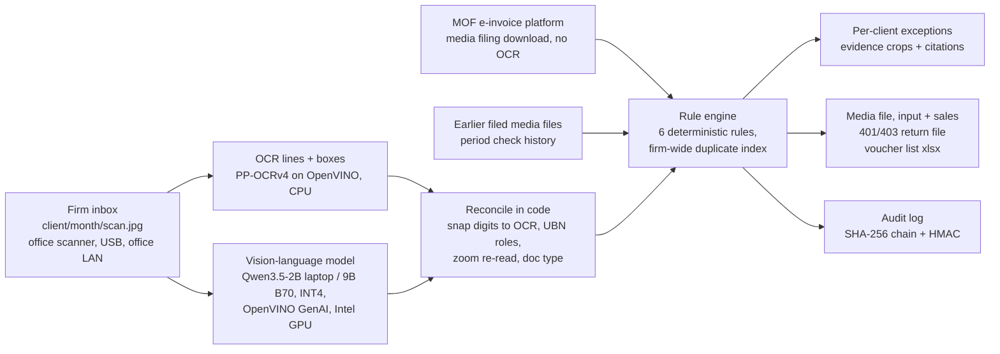

# Ledger Room

**A private receipt clerk for Taiwanese bookkeeping firms (記帳業者), on one machine inside the office.** The firm
gives it a client's box of paper vouchers. Ledger Room reads every voucher, books a value only when two independent
sources agree on it, and sends everything else to a person with the reason, so a misread does not slip into the VAT
return. Client data never leaves the office network.

### Evidence

**113 real invoices: the old ledger let 15 wrong rows through, Ledger Room let 0.**

Three headline facts, all on real documents (definitions: *let through* = a voucher with a wrong field accepted
without a person; *sent to a person* = held for a bookkeeper to check):

1. **The same 113 real invoices of one small company** ([data rule](#real-vouchers-from-one-company-stage-ii)).
   The company's old ledger (rows typed by a general chat AI, checked once by the owner): **15 wrong rows** (invoice
   number 7, date 6, total 3). Ledger Room, 9B on the B70, strict reading: **10 misread, all 10 held, 0 let through**;
   53 of 113 sent to a person. Compared on the three fields the old ledger keeps; on all six scored fields Ledger Room
   let 1 through, a seller tax ID (UBN), which the old ledger does not record.
   `eval/results_real_company.json` → `old_ledger_vs_ledger_room`
2. **Public real Taiwan photos, strict reading: 0 let through** on 41 (real_tw, re-scored after the fix: the strict
   rule was written after seeing this set) and 0 on 17 (real_tw2, first run, key frozen before any read).
   `eval/results_real_tw_strict.json`, `eval/results_real_tw2_strict.json` → `conditions.strict`
3. **Why the B70: the bigger reader is the accurate one, and it needs a workstation GPU: 3.7 s a voucher on the B70, 78 s on a laptop CPU.** Same real documents,
   strict reading, Qwen3.5-2B against Qwen3.5-9B:

   | Same real documents, strict reading | 2B | 9B |
   |---|---|---|
   | real_tw, 41 photos: fields wrong / sent to a person / let through | 18 of 164 / 21 / 1 | 11 of 164 / 14 / 0 |
   | real_tw2, 17 photos (first run): fields wrong / sent to a person / let through | 19 of 66 / 14 / 0 | 15 of 66 / 9 / 0 |
   | 336 real vouchers: share of fields wrong | 36.1% | 21.5% |
   | 113 real invoices: sent to a person / let through | 91 / 1 | 53 / 0 |

   The 9B takes 78.4 s a document on the laptop CPU and 3.7 s on one B70 (held-out synthetic set; laptop code
   c445b35, B70 code 3524145). `eval/results_real_tw_strict_2b.json`, `eval/results_real_tw2_strict_2b.json`,
   `eval/results_real_company.json` → `first_runs`, `old_ledger_vs_ledger_room`; `eval/results.json` →
   `larger_model`; `eval/results_b70.json`.

**Shipping mode: strict reading.** Set `LEDGER_STRICT_READ=1` (or `pipeline.STRICT = True`); this is the recommended
mode, and every Ledger Room count above uses it. The code default is still off. The trade: the default also accepts
an invoice number or date that only one source supports, so fewer vouchers go to a person but more misreads get through; strict sends more to a person and lets fewer through. On the
same reads: real_tw default 7 sent, 3 let through, strict 14 sent, 0 let through; the 336-voucher box default 220
sent, 34 let through, strict 257 sent, 11 let through (9 of the 11 are utility bills, now routed to the platform
instead; see [Real vouchers from one company](#real-vouchers-from-one-company-stage-ii)). Design:
[docs/strict_draft.md](docs/strict_draft.md).

**How it works, in short.** The firm scans each client's paper
vouchers into `client/month/` folders on one office machine (office scanner, USB stick or the office LAN; see
[docs/data_handling.md](docs/data_handling.md)) and adds the client's media filing download from the MOF e-invoice
platform, so e-invoices are imported, not photographed. OCR and a vision-language model
on OpenVINO (Qwen3.5-2B INT4 on the laptop iGPU in Stage I, Qwen3.5-9B INT4 on an Intel Arc Pro B70 in Stage II) read
every document. Deterministic code then checks Unified Business Number
(統一編號, UBN) checksums under the 2023 rule, duplicates within a client and across clients, VAT Act Art. 19
non-deductible items, client expense limits and filing periods. The bookkeeper gets a per-client exception list with
evidence crops and law citations, the client's full VAT media filing file (input and sales lines) and return data file
for forms 401 and 403 (the 401 pair passes the MOF offline checking program on synthetic data), a voucher list to import into accounting
software, and an HMAC-chained audit log, and nothing leaves the office network. On the held-out synthetic set, first blind run on the laptop (2B reader), Ledger Room scored micro F1 0.96;
the same model auditing on its own scored 0.15, and OCR with the same rules scores as well as Ledger Room on that clean
synthetic print (details under [Results](#results)). The real-photo first runs, their strict re-score and the
caveats on every set are under [Measured on the Intel Arc Pro B70](#measured-on-the-intel-arc-pro-b70-stage-ii).

Entry for the ASUS UGen AI League (Thunderstorm track, Workplace AI). Two kinds of numbers appear here, and each is
labelled: **Stage II** numbers were measured on the organiser's host with two Intel Arc Pro B70 cards (next section);
**laptop** numbers (Stage I, Intel Core i7-13620H, Intel UHD iGPU) are in [Results](#results) and the sections after it.

> **All data in this repository is SYNTHETIC.** Every company, Unified Business Number (統一編號, UBN), invoice
> number, amount and document image is generated by code (`synth/generate.py`, drawn with Pillow). No real people,
> no real business records, no AI-generated images. Any match with a real business is coincidental.
> The only exceptions are the real-photo rows in the B70 section (public photos and a public dataset, named there)
> and the aggregate counts from one company's petty-cash box (no images or values from it are in this repository).

## Reproduce on the B70 host

Linux host with Intel Arc Pro B70 cards, from a clone of this repository. Each command writes the results file named
after it; compare it with the committed copy in `eval/`.

```bash
bash scripts/setup_host.sh            # check the GPUs, make .venv, install, telemetry off, download the models, run the tests
.venv/bin/python -m eval.bench_b70    # held-out set, 9B and 27B, fresh reads -> eval/results_b70.json
.venv/bin/python -m eval.bench_concurrency --set heldout --k 1,2,3,4 --devices GPU.0 --models-root ~/models
                                      # readers per card, power, memory -> eval/results_concurrency.json
.venv/bin/python -m eval.bench_concurrency --set heldout --k 2,4,6,8 --devices GPU.0,GPU.1 --models-root ~/models --out results_concurrency_2cards.json
.venv/bin/python -m eval.offline_check --model-dir ~/models/Qwen3.5-9B-int4-ov --device GPU.0 --out results_offline_b70.json
                                      # network watch during a live batch -> eval/results_offline_b70.json
LEDGER_ZOOM_MIN_H=0 .venv/bin/python -m eval.repro_oor --mode pipeline --device GPU.0 --reps 8 --out ~/oor_pipeline.json
                                      # the B70 reader error: full reads with the UBN zoom strip as it was (0 = no padding);
                                      # drop LEDGER_ZOOM_MIN_H for the padded default -> summary in eval/results_oor_repro.json
.venv/bin/python -m eval.bench_concurrency --sets heldout,hard,blind3,main --k 2 --devices GPU.0,GPU.1 --duration-min 70 --models-root ~/models --out results_longrun_zoompad.json
                                      # 70 minutes, two cards, strip padded to 448 px (the default) -> eval/results_longrun_zoompad.json
python3 eval/util_sampler.py 72 ~/util_longrun_zoompad.csv   # start beside the long run; then --summary -> results_longrun_zoompad_util.json
                                      # the run before the fix (results_longrun.json): same command with LEDGER_ZOOM_MIN_H=0
```

The key fields to compare: `results["Qwen3.5-9B-int4-ov"].ledger_room.micro.f1` and `.reading.fields_wrong`
(`results_b70.json`), `rows[].docs_per_hour` and `rows[].power.wh_per_1000_docs` (`results_concurrency*.json`), `pass`
(`results_offline_b70.json`). Each bench reads 47 documents; the concurrency runs take about 3 minutes per row.

## Measured on the Intel Arc Pro B70 (Stage II)

Organiser's host: Intel Xeon 6787P, 251.5 GB RAM, two Intel Arc Pro B70 cards (`GPU.0`, `GPU.1`), OpenVINO
2026.4.1, Linux. Reader Qwen3.5-9B INT4 (`OpenVINO/Qwen3.5-9B-int4-ov`), thinking mode off, fresh reads (cache off).
Every number below was copied from the results file named in its row; synthetic sets are synthetic. Rows up to the
offline check use reader r8 (code 3524145 to 77fa568). The two readers-per-card rows use reader r9 (2aead27), which
reads the held-out set the same way (0 fields wrong under both). Reader r9 changed reading after the first blind3
run; its blind3 and hard-set numbers are in the after-the-fix table below the notes.

| What was run | Result | Source (file → key) |
|---|---|---|
| **Held-out** (47 synthetic docs, layout B), 9B + Ledger Room, one card | micro F1 1.00 (24 of 24 planted issues, 0 false alarms); key fields wrong 0/319; 3.7 s per document (mean). Same 9B auditing on its own: F1 0.20 | `eval/results_b70.json` → `results["Qwen3.5-9B-int4-ov"]` (code 3524145) |
| **Hard set** (49 synthetic docs with capture damage, all clean), 9B | 10 of 283 key fields a person can read were read wrong (8 left blank, 2 document types); every document with a wrong field went to a person; 15 of 49 sent to a person (code 8a0fc91) | `eval/results_hard.json` → `readers["Qwen3.5-9B-int4-ov + OCR"].overall` |
| Hard set, same 49 docs, later code (77fa568) | 46/320 key fields wrong, 18 of 49 sent to a person. See the note under this table: the two rows count differently | `eval/results_tiered.json` → `sets.hard.first_only` |
| **blind3, first official run** (53 synthetic docs in six layouts the code had never seen; key frozen before any run), 9B alone, code 77fa568 | micro F1 0.836 (found 23, missed 4, 5 false alarms); key fields wrong 40/326 (buyer UBN 10/26, net 10/26, tax 7/26, total 10/53); 11 of 53 sent to a person; 1 clean document flagged. Of the 13 documents with a wrong key field, 11 went to a person; 2 hotel statements were accepted with the seller UBN read as the client's own and the buyer UBN left blank | `eval/results_tiered.json` → `sets.blind3.first_only`; the 13 / 11 / 2 split: `eval/blind3_first_run_per_doc.json` → `summary` (per document: wrong field names, whether it went to a person and why; no read values) |
| **Real photos, Taiwan** (41 receipt and e-invoice photos from Wikimedia Commons, CC BY-SA; answer labels written by Claude, a different model from the readers, from the image only; first run, code 99f36fc) | Ledger Room (9B): 13/164 fields wrong, 5 photos sent to a person, 5 photos with a wrong field not stopped. 9B on its own: 28/164 wrong, 20 photos with a wrong field and nothing stops them. OCR only: 29/164 wrong, 38 photos sent to a person | `eval/results_real_tw_b70.json` → `["Qwen3.5-9B-int4-ov"].conditions` |
| **Real photos, Taiwan, strict re-score** (the same 41 photos, saved 9B reads re-scored, code fa8c027; **after the fix**: the strict rule was written after seeing this set's misses, so this is not a first run) | Default reading at this code: 11/164 fields wrong, 7 photos sent to a person, 3 photos with a wrong field not stopped. Strict reading: 14 sent to a person, 0 not stopped. Strict with the 27B as second reader (12 photos escalated): 14 sent, 0 not stopped. 2B (code b6fd8bd): 18/164 wrong; default 10 sent, 6 not stopped; strict 21 sent, 1 not stopped | `eval/results_real_tw_strict.json`, `eval/results_real_tw_strict_2b.json` → `conditions` |
| **Real photos, Taiwan, second blind set real_tw2** (17 other Commons photos, labels by Claude from the image only, key frozen before any read; first official run, code 968f9e0) | 9B: 15/66 fields wrong; default 8 sent to a person, 0 not stopped; strict 9 sent, 0 not stopped; strict with the 27B as second reader (9 escalated) 14/66 wrong, 9 sent, 0 not stopped. 2B (code b6fd8bd): 19/66 wrong; default 10 sent, 1 not stopped; strict 14 sent, 0 not stopped | `eval/results_real_tw2_strict.json`, `eval/results_real_tw2_strict_2b.json` → `conditions` |
| **Real vouchers, one company's petty-cash box** (336 vouchers; data rule and details in [Real vouchers from one company](#real-vouchers-from-one-company-stage-ii)) | 9B, strict: 257 sent to a person, 11 with a wrong field not stopped (9 of them utility bills); on the 113 invoices compared with the company's old ledger, 10 misread, all held | `eval/results_real_company.json` |
| **Real receipts, CORD v2** (193 receipts, validation + test splits, CC BY 4.0; total only, against the dataset's own ground truth; Taiwanese rules and Ledger Room's own reader not run) | 9B on its own: 3 of 193 totals wrong, none stopped. OCR + 9B, a total accepted only when two printed sources agree: 1 wrong and not stopped, 65 sent to a person (63 of those had been read right) | `eval/results_real_intl_cord_b70.json` → `["Qwen3.5-9B-int4-ov"].conditions` |
| **Two cards at once**, one 9B per card, started together, each card reading the same 47 held-out docs | 1,006 + 1,002 documents per hour (whole batch, wall clock); F1 1.00 and 0/319 fields wrong on both cards; no model reloads | `eval/results_dualcard_gpu0.json`, `eval/results_dualcard_gpu1.json` → `sets.heldout.first_only` (code 77fa568) |
| **27B as second reader** on the second card (the 9B reads everything, the 27B re-reads what the 9B is unsure of) | No gain. Hard set: 14 documents went to the 27B and 5 fields were taken from it, but still 18 of 49 to a person and 46/320 fields wrong, the same as the 9B alone. The unsure fields on that set are damaged on the image itself (covered, faded, written over), so a bigger reader has nothing more to read. Held-out: the 9B was unsure of no document. With the 27B as the only reader on held-out: F1 1.00, 0/319, 5.2 s per document against 3.7 s for the 9B | `eval/results_tiered.json` → `sets.hard.tiered` vs `sets.hard.first_only`; `eval/results_b70.json` → `results["Qwen3.5-27B-int4-ov"]` |
| **GPU driver error and workaround** | The first two blind3 attempts (code 7c3497b) stopped at document 8 of 53 with a GPU driver error (`CL_OUT_OF_RESOURCES`), before any scoring. Since then the bench reloads the 9B every 5 documents (`--first-restart-every 5`, about 9 s a reload). Counting the reloads, one card read 599 to 659 documents an hour (blind3 599, held-out 640, hard 651); leaving reload time out, 856 to 968. Replaced since by a fresh reader only after an error (after-the-fix table); cause found and fixed on 2026-11-07 (rows "Where the GPU error comes from" and "Long run, after the fix" below) | `eval/results_tiered.json` → `sets.blind3.note`, `sets.*.first_only` / `sets.*.tiered`: `docs_per_hour`, `docs_per_hour_excluding_first_reloads`, `first_restarts` |
| **Readers per card**, one B70, 1 to 4 copies of the 9B reading one queue of the 47 held-out docs (code 34f5246) | 1 reader: 1,034/h; 2 readers: 1,013/h; 3 readers: 993/h; 4 readers: 976/h: more reader processes did not raise the rate (batching not tried). Card memory 6.59 GB per reader (6.63 GB peak with one, 25.41 GB with four). Card power while reading 193.59 W, idle 64.18 W; 187.25 Wh per 1,000 documents (sampled power × read wall clock; the card's energy counter did not move). Scoring the same at every count: F1 1.00, 0/319 fields wrong, 0 sent to a person; no crashes | `eval/results_concurrency.json` → `rows[]`: `docs_per_hour`, `memory`, `power`, `scoring` |
| **Readers per card, both B70s**, the same queue split over two cards | 1 per card: 1,991/h; 2 per card: 1,944/h; 3 per card: 1,896/h; 4 per card: 1,857/h. One reader per card: 188.59 + 181.77 W while reading, 186.04 Wh per 1,000 documents. Same scoring as one card; no crashes. GPU.1 was not empty: before our readers loaded, another process on the shared host already held 14.86 GB of it (12.68 GB before the 4-per-card row), and with 3 and 4 readers per card GPU.1 ran full (31.89 GB), so the per-reader memory estimate there drops to 5.68 / 4.8 GB. The 2, 3, 4 per card rates may be held down by that; the one-card rows are not affected | `eval/results_concurrency_2cards.json` → `rows[]` |
| **Long run, both B70s, before the fix**, one 9B per card, the held-out, hard, blind3 and main sets in a loop for 70 minutes (code 48ebaf8; UBN zoom strip not padded) | 2,201 documents read in 70.0 min: 1,886/h, GPU.0 1,102 (944/h), GPU.1 1,099 (942/h). 28 reader restarts (24/h for the two cards; 12 on GPU.0, 16 on GPU.1), every one after a GPU plugin error (`CL_OUT_OF_RESOURCES`); 0 process crashes; reloading after restarts took 230.6 s, about 5% of the time. 3 of 2,201 documents (0.14%) were not read and went to a person (reason `reader_error`). Power 189.4 + 183.6 W while reading; 200.6 and 195.0 Wh per 1,000 documents (sampled watts × wall clock; the energy counter did not move). Scoring over time: held-out F1 1.00 in all 11 passes; blind3 17 or 18 key fields wrong in every pass (one document read differently between passes), 12 sent to a person every pass; the hard and main sets differ between passes only where a document was not read. The hard set has no planted issues, so its rule F1 is 0 by construction as soon as anything is flagged (read its 18 documents sent to a person, the same every pass, instead); main pass 5 scored F1 0.979 because one document was not read | `eval/results_longrun.json` → `rows[0]`: `docs_per_hour`, `per_device`, `restarts`, `docs_not_read_reader_failure`, `power`, `stability`, `passes[]` |
| **Compute engine busy**, both B70s, during the long run before the fix | GPU.0: busy 86% of the time (median 90%); GPU.1: 84% (median 89%). `xpu-smi` returns N/A for engine utilisation on this host, so `eval/util_sampler.py` read the Xe driver's DRM fdinfo every 5 s. Busy means the compute engine had work queued; it does not say how many execution units were active | `eval/results_longrun_util.json` → `cards`; raw samples `eval/longrun/util_longrun.csv` |
| **Where the GPU error comes from**: the 40 landscape photos around the long-run failures, 8 reads each per card (code c370a45) | The reader error comes from one image the reader sends the model: the UBN zoom strip, a crop about 852 × 140 px. Reading only the page: 0 of 640 reads failed. The full read (OCR and every model call): 4 of 640 failed, every one on that strip. The same full read with the strip padded with white to 448 px high: 0 of 640. 4 of 640 against 0 of 640 alone is suggestive (one-sided Fisher exact p about 0.06); the long run below is the larger test. Padding to 448 px is the default since a49cc19 (`LEDGER_ZOOM_MIN_H`, 0 turns it off). Not yet reported to OpenVINO | `eval/results_oor_repro.json` → `page_read_only`, `full_pipeline_before`, `full_pipeline_strip_padded_to_448`, `runs.*.error_calls` |
| **Long run, both B70s, after the fix**, the same four sets in a loop for 70 minutes, strip padded to 448 px (code c370a45 with `LEDGER_ZOOM_MIN_H=448`, the default from a49cc19) | 2,383 documents read in 70.0 min: 2,042/h, GPU.0 1,203 (1,031/h), GPU.1 1,180 (1,011/h). 0 reader restarts (28 before), 0 crashes, 0 documents sent to a person unread (3 before). Power 197.0 + 191.5 W while reading; 190.26 Wh per 1,000 documents (sampled watts × wall clock; the energy counter did not move). Every complete pass of every set scored the same: held-out F1 1.00, 0 key fields wrong, in 12 passes; blind3 18 key fields wrong and 12 of 53 sent to a person in 12 passes; main F1 1.00 in 11 passes; hard 45 key fields wrong and 18 of 49 sent to a person in 12 passes (rule F1 0 by construction, nothing planted) | `eval/results_longrun_zoompad.json` → `rows[0]`: `docs_per_hour`, `per_device`, `restarts`, `docs_not_read_reader_failure`, `power`, `stability` |
| **Compute engine busy**, both B70s, during the long run after the fix | GPU.0: busy 91% of the time (median 92%); GPU.1: 91% (median 92%), against 86% and 84% before the fix. Same method: Xe DRM fdinfo every 5 s | `eval/results_longrun_zoompad_util.json` → `cards`; raw samples `eval/longrun/util_longrun_zoompad.csv` |
| **Offline check** on the B70 | PASS: 47 documents read live, 175.8 s watched, 0 connections to a non-local address. The network adapter stayed up (a cloud host cannot unplug it), so this is not a cable-pulled test | `eval/results_offline_b70.json` |

**Hard set, why two rows.** Both runs are the 9B with reader r8 on the same 49 documents. `eval/hard_eval.py` (first
row) does not score the 37 key fields that the answer key marks as unreadable by a person, because the right outcome
there is to send the document to a person; `eval/read_accuracy.py`, used by `eval/bench_tiered.py` (second row),
scores every field. 36 of those 37 were read wrong or blank, so 10/283 and 46/320 are the same reading. The 3 extra
documents sent to a person come from a rule added between the two runs (8031031: a blank invoice number or seller UBN
on an invoice goes to a person); in the 8a0fc91 run, 3 of the 4 documents that should have gone to a person and did
not had a blank invoice number. For how well the reader reads, quote 10/283; for what the current code sends to a
person, quote 18 of 49.

**blind3 stays a first run.** These are the numbers of the first and only official blind3 run. Reader r9 (2aead27)
was changed afterwards because of what this run showed (an invoice number split by OCR taken for the buyer UBN,
amounts written one digit per box, a seller UBN equal to the client's own). Anything measured with r9 is labelled
"after the fix" and does not replace the rows above.

**Documents per hour, plainly.** Over 70 minutes on two B70s, one 9B reader per card read 2,042 documents an
hour: about 1,000 per card (1,031 and 1,011), with no restarts. That matches the 47-document batches (1,034 on one card,
1,991 on two), so the long run is the number to plan with. More reader processes on the same card did not raise the
rate (1,013, 993, 976 with 2, 3, 4). Each card's compute engine was busy 91% of the time: one reader keeps it busy
most of the time; batching inside one reader has not been tried. A card draws about 190 W while reading, about
0.19 kWh per 1,000 documents (sampled). The 32 GB on a B70 is headroom (the 9B needs about 6.59 GB, the 27B fits),
not a reason to stack readers.

The GPU driver error is fixed. Before the fix, the reader hit a GPU plugin error (`CL_OUT_OF_RESOURCES`) about every
5 minutes per card: the first 70-minute run had 28 restarts, 3 of 2,201 documents sent to a person unread, 1,886
documents an hour and the compute engines busy 86% and 84%. The error came from one image, the thin UBN zoom strip
(about 852 × 140 px); padding it to 448 px high gave 0 errors in 640 reads and 0 restarts in the 70-minute run after
the fix. Not yet reported to OpenVINO. The 599 to 659 an hour in the reload row above was the first workaround.

<!-- r9 after-fix rows go here -->

**After the fix: reader r9 (2aead27).** Not an independent test any more: r9 was changed because of what the first
blind3 run showed. The first-run rows above stay the headline.

| What was run | Result | Source (file → key) |
|---|---|---|
| Held-out, 47 docs, 9B alone | F1 1.00, 0/319 key fields wrong, 0 of 47 sent to a person | `eval/results_after_fix_r9.json` → `sets.heldout.first_only` |
| Hard set, 49 docs, 9B alone (first reader only; the 27B pass was not run, which is why the file says incomplete) | 45/320 key fields wrong, 18 of 49 sent to a person, 2 clean documents flagged | `eval/results_after_fix_r9.json` → `sets.hard.first_only` |
| blind3, 53 docs, 9B alone, restart-on-error bench (7d00d4d) | F1 1.00 (found 27, missed 0, 0 false alarms), 18/326 key fields wrong, 12 of 53 sent to a person, 0 clean documents flagged; 883 documents an hour; one reader error (`CL_OUT_OF_RESOURCES`) recovered by a fresh process, no fixed reloads. A first attempt (bench 34f5246) reused the broken process and was discarded | `eval/results_after_fix_r9_blind3.json` → `rows[0]` |

### Real photos: first run, then strict reading

On 41 real Taiwan receipt photos (real_tw, first run on the B70) the 9B on its own let 20 photos with a wrong field
through. Ledger Room with the default reading stopped 15 of them and sent 5 photos to a person; OCR with the same
rules let 1 through but sent 38 to a person. That was the trade of the default reading: 4 more wrong photos got
through than with OCR and the rules, and a person opened 5 photos instead of 38. The first-run row above stays the
record of that run.

Those misses led to strict reading ([docs/strict_draft.md](docs/strict_draft.md)). The same saved reads were
re-scored: the default reading at the newer code lets 3 through and sends 7 to a person; strict lets 0 through and
sends 14. The strict rule was written after seeing this set, so that is an after-the-fix number. The first blind test
of strict reading is real_tw2 (17 photos, key frozen before any read, first run): 0 let through and 9 sent to a person
with strict reading, 0 and 8 with the default. Answer labels on both public sets were written by Claude, a different
model from the readers, from the image only; no person checked them.

### Real vouchers from one company (Stage II)

**Data rule.** One small Taiwanese company's petty-cash box, used with the owner's consent. Only aggregate counts are
published: no images, no company name, no tax ID, no per-voucher values. The images, the answer key and the
per-voucher files stay outside git. Every other mention of "the real company box" in this README refers to this set
and this rule.

The box holds 336 vouchers: 83 e-invoices, 24 triplicate invoices, 14 two-part cash-register invoices, 155 utility
bills, 34 postage receipts, 14 tax bills and 12 receipts. Answer key: 4 labelers read the page images only (no ledger,
no OCR, no Ledger Room output), frozen (sha256 prefix fcff2ca60a393f7d) before any Ledger Room read; it was not made
or checked by a bookkeeper. Fields scored: invoice number, date, seller UBN, total, net, tax (a utility bill's printed
invoice number is the previous period's e-invoice). First runs on one B70 (`GPU.0`):

| First run, 336 vouchers | 9B (code fa8c027) | 2B (code b6fd8bd) |
|---|---|---|
| Seconds a photo on the B70 | 3.87 | 2.45 |
| Share of fields wrong: OCR only / model alone / Ledger Room | 60% / 27% / 21.5% | 60% / 68.1% / 36.1% |
| Default reading: sent to a person / wrong and not held | 220 / 34 | 262 / 34 |
| Strict reading: sent to a person / wrong and not held | 257 / 11 | 309 / 7 |
| Strict, the 121 invoices only: sent to a person / with a wrong field / wrong and not held | 56 / 52 / 1 | 98 / 79 / 4 |

Strict counts were re-scored from the same reads (`eval/strict_rescore.py`). With strict reading the 2B lets fewer
vouchers through over the whole box (7 against 11) because it sends 52 more to a person; on the invoices it lets more
through (4 against 1). Of the 9B's 11 strict misses, 9 are utility bills, 1 a tax bill and 1 a triplicate invoice
(`by_kind_9B`). The 27B as second reader on the 9B's strict run: 164 photos escalated, 5.96 s each, 241 sent to a
person, still 11 not held, share of fields wrong 18.2%.

**Against the company's old ledger.** The company's own ledger rows for its invoices were typed by a general cloud chat
AI and checked once by the owner. 113 of the 121 invoices could be paired with a ledger row (106 by exact invoice
number, 7 by a near-miss number with the same date or amount), compared on the three fields that ledger keeps:
invoice number, date, total.

| Same 113 invoices | Wrong | Wrong and not held | Sent to a person |
|---|---|---|---|
| Old ledger (chat AI, checked once) | 15 rows (invoice number 7, date 6, total 3) | 15 (nobody held them) | n/a |
| Ledger Room 9B, strict | 10 | 0 | 53 |
| Ledger Room 9B, default | 10 | 0 | 52 |
| Ledger Room 2B, strict | 36 | 1 | 91 |
| Ledger Room 2B, default | 36 | 13 | 52 |

Not a person-versus-machine race: the old ledger is one way a small company actually kept its books. On all six
scored fields the 9B let 1 of the 113 through (a seller tax ID), which the old ledger does not record.

**After the fix: utility bills routed to the platform.** The utility-bill keywords (commit 1d7a07c) were written after
seeing this box, so these are after-the-fix numbers on the same saved reads, no model run. A recognised utility bill is
not booked from paper: its input tax comes from the utility's e-invoice on the MOF platform, and the bill is kept as
proof of payment. It is neither held nor exported. Recognised: 155 of 155, 0 false (OCR text only;
`eval/results_utility_detect.json`). 9B strict: 112 sent to a person (257 before), 2 wrong and not held outside the
bills (11 before, 9 of them bills); default 109 and 2. 2B strict: 157 and 4; default 114 and 27.

All counts: `eval/results_real_company.json` (`first_runs`, `by_kind_9B`, `invoices_121`, `old_ledger_vs_ledger_room`,
`after_fix_utility_routing`). Page splitting on the same box: [Stage II progress](#stage-ii-progress).

## Why a bookkeeping firm needs this

- Taiwan has about 8,600 bookkeeping firms, and the Ministry of Finance inspects their personal-data safeguards
  every year (703 firms in 2025) ([news, 2025-11-26](https://www.ctee.com.tw/news/20251126701522-430104)).
- The bookkeepers' personal-data safeguard regulation
  ([記帳士與記帳及報稅代理人個人資料檔案安全維護管理辦法](https://law.moj.gov.tw/LawClass/LawAll.aspx?pcode=G0340165))
  asks a firm to supervise outsourced processing (Art. 10), to check MOF restrictions and tell clients before any
  international transfer (Art. 11), to give staff different permissions (Art. 15), and to keep usage records and
  system trail data for at least five years (Art. 19 of this regulation, not the VAT Act's Art. 19). A firm whose systems hold 10,000 or more personal-data records
  must also have user identity checks, display masking, access control and monitoring of abnormal use (Art. 17).
  Sending client receipts to an overseas cloud model is exactly the kind of transfer that needs that paperwork. A
  local model avoids it, and the controls below map to this regulation's Arts. 15, 17 and 19.
- The UBN check-digit rule changed in 2023 (divisible by 10 became divisible by 5), so older checking code wrongly
  rejects newly issued numbers ([MOF Fiscal Information Agency](https://www.fia.gov.tw/singlehtml/3?cntId=c4d9cff38c8642ef8872774ee9987283)).
- A firm sees all of its clients' vouchers. Only a firm-level system can notice the same receipt claimed by two
  different client companies.

## Who buys it and when it pays back

The buyer is the bookkeeping firm, in two versions:

- **Pro**: one ASUS workstation with an Arc Pro B70 and the 9B reader, for larger bookkeeping firms or CPA firms.
  Box NT$81,590–148,189 at Taiwan prices read on 2026-11-07 (a parts build plus the card, up to an ASUS WS780T plus the
  card; card NT$51,290), plus a licence of NT$1,500–3,000 a month per firm (our proposal).
- **Lite**: the firm's own laptop with the 2B reader, for small bookkeeping firms; licence only.

Method (our calculation): the saving is 45 s of keying a voucher (published estimates 30–60 s) at NT$219 a staff hour
(NT$38,000 a month, MOL 2025 occupational wage survey, no employer costs), counted only for vouchers that pass
without a person; a held voucher saves nothing. Share that passes, real data, strict reading: 9B 54% (the real
company's 121 invoices) to 66% (the 41 public photos); 2B 19% to 49%. Vouchers a month are our assumption, paper
only (e-invoices come from the platform download; scanning not counted).

| Paper vouchers a month | Pro: payback | Lite: net a month |
|---|---|---|
| 10,000 | 5–13 months | +NT$2,200 to +NT$11,900 |
| 5,000 | 11–34 months | −NT$400 to +NT$5,200 |
| 2,000 | no payback in 3 years (39 months at best): Lite | −NT$2,000 to +NT$1,200 |

Pro best case: cheaper box, higher pass share, lower licence; worst case the opposite. At 10,000 vouchers a month and
30 s a voucher: 8–22 months; at 60 s: 4–9 months. The keying speed comes from published estimates, not a timing in a
firm, and a held voucher's check time is not counted; a pilot firm would measure both. The speed was measured on the
organiser's Xeon host, not on the box priced here.

## What it checks

The model only reads. Every decision below is made by code in `ledger_room/rules.py`, and each exception links to its source.

| Rule id | What it catches | Source |
|---|---|---|
| `UBN_CHECKSUM` | A seller or buyer UBN that fails the 2023 mod-5 rule (with the 7th-digit-is-7 case). Also explains when a number passes the new rule but would fail the old one. | [FIA notice](https://www.fia.gov.tw/singlehtml/3?cntId=c4d9cff38c8642ef8872774ee9987283) |
| `DUP_CROSS_MONTH` | The same voucher submitted again by the same client (same invoice number, or same seller + date + total) | With input tax for this client: deducting it twice may constitute over-claimed input tax (虛報進項稅額), [VAT Act Art. 51(1)(5)](https://law.moj.gov.tw/LawClass/LawSingle.aspx?pcode=G0340080&flno=51); the bookkeeper decides. Without (e.g. a taxi receipt): [Income Tax Act Art. 24](https://law.moj.gov.tw/LawClass/LawSingle.aspx?pcode=G0340003&flno=24) and [Audit Regulations Art. 67(1)](https://law.moj.gov.tw/LawClass/LawSingle.aspx?pcode=G0340051&flno=67) (an expense without an original voucher is in principle not recognised) |
| `DUP_CROSS_CLIENT` | The same voucher filed under two different clients. The period check extends it to e-invoices: an invoice on one client's platform download (the platform names the buyer) that turns up in another client's paper, or on two clients' downloads | As above, plus [VAT Act Art. 33](https://law.moj.gov.tw/LawClass/LawSingle.aspx?pcode=G0340080&flno=33) when input tax is claimed |
| `S19_NONDEDUCTIBLE` | Input tax claimed on entertainment or gifts, employee personal benefits, a passenger car for own use, or non-business items | [VAT Act Art. 19](https://law.moj.gov.tw/LawClass/LawSingle.aspx?pcode=G0340080&flno=19) |
| `OVER_LIMIT` | A document above the client's own expense policy (meal, taxi, lodging, approval threshold) | client policy in `clients.json` |
| `PERIOD_MISMATCH` | A date after the filing period (VAT is filed per two-month period, by the 15th of the next odd month: September–October by 15 November), or an e-invoice period header that does not contain its own date. A date **before** the period is only a warning: input tax may be claimed in a later period (from the second period on, with a stated reason, up to ten years) | [Art. 35](https://law.moj.gov.tw/LawClass/LawSingle.aspx?pcode=G0340080&flno=35), [Enforcement Rules Art. 29](https://law.moj.gov.tw/LawClass/LawSingle.aspx?pcode=G0340081&flno=29) |

Severities: a match on seller + date + amount without a shared invoice number is a **possible duplicate** (warning:
two same-day taxi rides at the same fare are normal); a shared invoice number is a duplicate (high). VAT Act Art. 19 matches on
alcohol and meal words are **to confirm** (warning: a restaurant buys beer to resell); gifts, staff trips and passenger
cars stay findings. A payment slip or transaction detail is paired with any document of the same date and amount and
reported as a possible duplicate (a meal detail and its Line Pay slip are one purchase).

Routing rules, outside the six evaluated types (the answer keys were frozen before them), reported separately:

| Rule id | What it does | Source |
|---|---|---|
| `AMOUNT_MISMATCH` (hold) | net + tax must equal the total and tax must be 5% of net (NT$1 rounding); a voucher the client would deduct also needs both amounts read. Held until corrected. | arithmetic, 5% standard rate |
| `BUYER_NOT_CLIENT` | buyer UBN missing (consumer-style invoice: expense only) or another company's: no deductible input tax. A two-part invoice (二聯式) without the buyer's UBN is never deductible; a two-part cash-register invoice that carries this client's UBN is (format code 22, [Enforcement Rules Art. 38](https://law.moj.gov.tw/LawClass/LawSingle.aspx?pcode=G0340081&flno=38)) | [VAT Act Art. 19(1)(1)](https://law.moj.gov.tw/LawClass/LawSingle.aspx?pcode=G0340080&flno=19), [Art. 33](https://law.moj.gov.tw/LawClass/LawSingle.aspx?pcode=G0340080&flno=33) |
| `BUYER_PRESUMED` (hold) | buyer UBN unreadable but the buyer name looks like the client: never deducted on a guess | Art. 33 |
| `NOT_A_VOUCHER` (hold) | a payment slip or a transaction / order detail (printed keywords, traditional or simplified), or a slip with neither seller UBN nor invoice number: not a voucher on its own; ask the client for the invoice | [Audit Regulations Art. 67](https://law.moj.gov.tw/LawClass/LawSingle.aspx?pcode=G0340051&flno=67) |
| `IN_PLATFORM` (info) | a photographed invoice whose number is already in the client's e-invoice platform download for the period: not entered again (the platform line stands for it), so the same input tax is not claimed twice | [VAT Act Art. 51(1)(5)](https://law.moj.gov.tw/LawClass/LawSingle.aspx?pcode=G0340080&flno=51) |
| `VOID_ON_PLATFORM` (hold) | a photographed invoice the platform download marks voided: held, and never written to the filing file | [VAT Act Art. 51(1)(5)](https://law.moj.gov.tw/LawClass/LawSingle.aspx?pcode=G0340080&flno=51) |
| `DUP_PRIOR_FILING` (high, period check) | an invoice about to be claimed this period (a platform line, or a paper line that would be filed) whose number and seller UBN are already in a media file the client filed for an earlier period. Invoice tracks are reused across years, so the seller must match too; without a seller UBN the number alone decides | [VAT Act Art. 51(1)(5)](https://law.moj.gov.tw/LawClass/LawSingle.aspx?pcode=G0340080&flno=51), [Enforcement Rules Art. 29](https://law.moj.gov.tw/LawClass/LawSingle.aspx?pcode=G0340081&flno=29) |
| `PLATFORM_AMOUNT_DIFF` (hold, period check) | a photographed invoice whose number is on the client's own platform download (`IN_PLATFORM`) but whose total or seller UBN differs: the platform line is held until the paper and the seller are checked (skipped when the photo's total already went to a person) | [營業稅電子資料申報繳稅作業要點 第二十點, 附件五](https://law-out.mof.gov.tw/LawContent.aspx?id=GL009478), [Audit Regulations Art. 67(1)](https://law.moj.gov.tw/LawClass/LawSingle.aspx?pcode=G0340051&flno=67) |
| `PLATFORM_RECORD_CONFLICT` (hold, period check) | one invoice twice in the client's platform downloads with different amounts or sellers (identical re-downloads are merged): only one may be filed | [VAT Act Art. 51(1)(5)](https://law.moj.gov.tw/LawClass/LawSingle.aspx?pcode=G0340080&flno=51) |
| `CUSTOMS_KEY_BY_HAND` (hold) | a customs-collected VAT payment certificate (format code 28) is recognised from its printed words and always held: the bookkeeper keys the certificate number and tax by hand; Ledger Room does not read it into the filing file | [Enforcement Rules Art. 38(1)(2)](https://law.moj.gov.tw/LawClass/LawSingle.aspx?pcode=G0340081&flno=38) |
| `UTILITY_BILL_PLATFORM` (info) | an electricity, water, telecom or gas bill or payment notice, recognised from printed words: a utility's name and a bill marker (such as 繳費期限 or 應繳總金額), never on an e-invoice proof (證明聯). Not keyed and not sent to a person: its input tax comes from the utility's e-invoice in the platform download, and the bill is kept as proof of payment. The invoice number printed on it (an earlier period's e-invoice) is not used for duplicates, and the bill never becomes a line in the export, the filing file or the voucher list. With the platform download loaded, the message says whether a platform record has the same seller UBN and total | [VAT Act Art. 33](https://law.moj.gov.tw/LawClass/LawSingle.aspx?pcode=G0340080&flno=33), [Art. 51(1)(5)](https://law.moj.gov.tw/LawClass/LawSingle.aspx?pcode=G0340080&flno=51) |
| `SMALL_RECEIPT_CAP` (warning) | plain receipts (普通收據) from small businesses (printed 免用統一發票), cumulative per client, above 3% (千分之三十) of the year's manufacturing expenses plus operating expenses (`annual_manufacturing_expenses` + `annual_operating_expenses` in `clients.json`, ideally the amounts the tax office assesses); off unless both are set. Other receipts are not capped by this rule | [Audit Regulations Art. 67(3)](https://law.moj.gov.tw/LawClass/LawSingle.aspx?pcode=G0340051&flno=67) |

Deduction codes: the export sets 1 (deductible purchases and expenses) or 3 (non-deductible, VAT Act Art. 19). Codes 2
and 4 (fixed assets) are not set automatically: a `FIXED_ASSET_HINT` warning says why a line may be one (net of
NT$80,000 or more, or an equipment word), and the bookkeeper changes the code.

Optional, off in the evaluation: `UBN_NOT_REGISTERED` (warning). With a local copy of the MOF business-registration
open data ([data.gov.tw dataset 9400](https://data.gov.tw/dataset/9400), set `LEDGER_REGISTRY` to the .zip or .csv),
a checksum failure one digit away from a registered business is reported as a likely misread, and a well-formed
number that is not registered gets a warning. `ledger_room/registry.py`; tested on a small fixture only, not yet on
the downloaded file.

## How it works



1. **Read.** OCR finds text lines, exact digits and their positions. The vision-language model sees the photo plus the
   OCR lines and returns the document as JSON (type, invoice number, date, seller and buyer, UBNs, items, totals, notes).
2. **Reconcile (code).** Model digits are snapped to the printed OCR digits when they differ by at most two places.
   UBN roles come from the words around each number (賣方 / 買方 / 買受人 / the red seller stamp), so a model that copies
   the seller's number into the buyer field is overruled. When the buyer UBN is printed in boxes that OCR misses, code
   crops the area next to the label, enlarges it and reads it again. The total, net and tax are picked by code from
   the printed rows (cash, change, balance and deposit lines never count); the model's own reading is one vote, and a
   total without two agreeing sources goes to a person. Every field keeps its provenance
   (`ocr-confirmed`, `snapped`, `ocr-zoom`, `model-only`, ...).
3. **Check (code).** The six rules run across the whole firm at once, which is what makes cross-client duplicates visible.
4. **Show, export and log.** The web app lists exceptions per client with the evidence crop, the field provenance and
   the official citation. Each run also writes `export_media.csv`: one line per document, laid out like the input records of the VAT media
   filing file (進項媒體申報檔), with the format code (格式代號 21 / 22 / 25 / 28), the deduction code (扣抵代號 1, or 3 when VAT Act Art. 19 applies; 2 and 4 for fixed assets are
   set by hand), the ROC date and a status (`READY`, shown as pre-checked because a bookkeeper still signs off every
   line; `HOLD` until an exception is resolved; or `NOT_IN_FILE` for a voucher without input tax or one already in the
   platform download). `ledger_room/filing.py` builds the client's filing files from the pre-checked lines and the
   platform download, and `ledger_room/voucher_export.py` writes the voucher list for accounting software (see
   [Stage II progress](#stage-ii-progress)); the 401 pair passes the MOF offline checking program on a synthetic client, and
   nothing has been imported into accounting software yet. Every read and every exception goes into an append-only
   JSONL log (see [Access control and the audit log](#access-control-and-the-audit-log)).
5. **E-invoices without OCR.** Most input vouchers already exist on the MOF e-invoice platform, and a bookkeeper the
   client has authorised can download them. `ledger_room/einvoice_platform.py` reads the platform's media filing
   download (one `<UBN>.txt` per client, 81-character records, input and sales lines) from `data/platform/<client UBN>/`,
   and the web app loads it for every run. A photographed invoice already in it is not entered again (`IN_PLATFORM`);
   one the platform marks voided is held (`VOID_ON_PLATFORM`) and never filed. The download carries no item names, so
   the VAT Act Art. 19 keyword check runs on platform lines only when a carrier export with item names sits next to
   the download (step 6). The reader follows the layout shown in the platform
   manual; no real download has been parsed yet (that needs the client's login). Photos are for paper vouchers the
   platform does not have. Separately, `ledger_room/einvoice.py` imports a consumer's e-invoice CSV export (UTF-8 or
   Big5, footnote lines skipped, line items grouped into invoices, discount and zero-price lines kept); it was run once
   on one person's own consumer e-invoices (aggregates under [Results](#results)).
6. **Period check: every voucher of the period, e-invoices and paper together.** Paper is the smaller part of a
   firm's input vouchers (about 15% of uniform invoices were paper in 2023), so the check that matters is the one
   before the return goes out. `ledger_room/period_check.py` takes, per client and period, the platform download, an
   optional carrier export with item names (`*.csv` next to the download), the media files the firm already filed
   for earlier periods (`data/filed/<client UBN>/`) and the paper run, and runs one set of checks across all of them:
   `DUP_PRIOR_FILING`, `PLATFORM_AMOUNT_DIFF`, `PLATFORM_RECORD_CONFLICT`, `DUP_CROSS_CLIENT` across platform lines
   and paper, VAT Act Art. 19 on platform lines that have item names, and `FIXED_ASSET_HINT` on platform lines of
   NT$80,000 or more. Each voucher ends as ready to book, held for a person, booked from its platform line (a photo of
   an invoice the platform already has), or left out (a voided platform line). The web app runs it with every batch
   and shows one line above the exceptions ("This period: N e-invoices (from the platform download) + M paper
   vouchers (read), K held for a person"); held e-invoices appear in the same list, marked as coming from the
   platform. Not checked, and said so in the report: Art. 19 on platform lines without item names (the media file
   has none), B2B exchange invoices the buyer has not confirmed (the media file has no such field), and whether a
   photographed e-invoice should be on the download (upload delays make an absence weak evidence). The `heldout`
   inbox has synthetic platform downloads and earlier filings (`synth/period_demo.py`) so the screen has something
   to show; the evaluation does not load them.

Scans are working copies. The paper originals stay with the client and are kept at least five years (Art. 27 of the
regulation on account books and vouchers); Ledger Room does not replace paper. Documents should reach the box through
the office scanner, a USB stick or the office LAN. LINE or e-mail is a transfer through a third party's servers: if a
client insists on it, that is the client's choice, and the file is imported, then deleted
([docs/data_handling.md](docs/data_handling.md)).

## Access control and the audit log

What is in place, and what it does not do:

- **Binds to 127.0.0.1.** Without user accounts the web app is a single local user and refuses any other address.
- **Accounts and roles** (regulation Arts. 15 and 17(1)(1)): `python -m web.users add NAME --role admin|staff` stores
  PBKDF2-SHA256 password hashes in `%LOCALAPPDATA%\LedgerRoom\users.json`. With accounts, every request except the
  sign-in page needs a session (8 hours, HttpOnly, SameSite=Strict); five wrong passwords lock that name for five
  minutes. Staff can read exceptions and documents, replay runs and export; only an admin can run the model live and
  read the logs. Only then may `--host 0.0.0.0 --cert cert.pem --key key.pem` share it on the office LAN over HTTPS
  (or `--host 0.0.0.0 --behind-tls-proxy` when an HTTPS reverse proxy sits in front); it refuses plain HTTP off loopback.
- **Operation log** (regulation Arts. 17(1)(4), 17(1)(6) and 19): sign-ins, failed sign-ins, runs, result views, log views and
  exports are appended to `data/out/oplog.jsonl` with the user and IP address.
- **Tamper evidence, not tamper proof.** Each log entry carries the SHA-256 of the previous entry and an HMAC-SHA256
  under an operator key (`%LOCALAPPDATA%\LedgerRoom\audit.key`, created on first use, outside the data folder). The
  plain hash chain alone only shows accidental damage, because anyone who can write the disk can recompute it. The
  HMAC lets whoever holds the key detect an edited, inserted or removed entry (`tests/test_audit_log.py` forges a
  re-chained log and the HMAC catches it). It does not stop someone who holds both the disk and the key, so for real
  use the key belongs on a separate USB key or Windows account (`LEDGER_AUDIT_KEY_FILE`). Signing with a hardware key
  is Stage II work.
- **Display masking** (regulation Art. 17(1)(2)): names that read as a person's, phone and ID numbers and e-mail
  addresses are masked by default in the web app, the CSV export and the log views. Only an admin can unmask, with a
  reason, and each unmask goes into the operation log (`ledger_room/privacy.py`, [docs/data_handling.md](docs/data_handling.md)).
- **Contract end** (regulation Art. 19): `python -m ledger_room.privacy purge` deletes a client's working copies, keeps
  the logs and writes a deletion record to the operation log.
- **Encryption at rest:** Ledger Room relies on the disk's full-disk encryption (BitLocker, LUKS, FileVault) and warns
  at start-up when the data folder is not on an encrypted volume. Network intrusion defence (regulation Art. 17(1)(5))
  is the firm's network setup. Usage records must be kept five years (regulation Art. 19); Ledger Room never deletes
  logs, but retention is the firm's backup policy.
- **Security review, 2026-11-07:** a Claude Security scan of `web/` and `ledger_room/` found 9 issues (0 critical, 0
  high, 7 medium, 2 low). All 9 are fixed, together with 8 fixes from a code review (878f798). 290 tests passed (1
  skipped) at the time of the review; the suite has grown since.

## Model and runtime

| Part | Choice | License |
|---|---|---|
| Vision-language model | [OpenVINO/Qwen3.5-2B-int4-ov](https://huggingface.co/OpenVINO/Qwen3.5-2B-int4-ov) (Intel's pre-converted INT4 build of Qwen3.5-2B) | Apache-2.0 |
| Model runtime | OpenVINO GenAI 2026.4 `VLMPipeline`, device `GPU` (Intel GPU), falls back to `CPU` | Apache-2.0 |
| OCR | PP-OCRv4 det/rec models from the `rapidocr-onnxruntime` wheel, executed by OpenVINO | Apache-2.0 |

Why this path: it runs on the laptop's Intel UHD iGPU today through the same OpenVINO GPU plugin that drives Intel Arc,
and it follows the toolchain of ASUS's own Arc Pro B70 sample (OpenVINO + Qwen3.5 vision models). The measured
alternatives are in the results block below.

**Intel Arc Pro B70 path.** This paragraph is the Stage I reasoning, written on the laptop before any B70 run; what
the B70 then measured is under [Measured on the Intel Arc Pro B70](#measured-on-the-intel-arc-pro-b70-stage-ii). What
the laptop showed (see [Results](#results)): the 2B reader is fast enough even on the laptop iGPU, and since code picks
the amounts it ends with every key field right on the synthetic held-out set. Real photos are harder: on the 10 real
receipts the 2B still sends 6 of 15 captures to a person, the 9B (`OpenVINO/Qwen3.5-9B-int4-ov`, same code, thinking
mode off) 4 of 15. On the laptop the 9B only ran on the CPU (compiling it for the iGPU ran out of memory, since the
iGPU shares system RAM), at more than a minute per document. That is why the B70 is in the plan: 32 GB of dedicated memory holds the 9B (5.9 GB) or a
27B INT4 reader (about 15 GB) next to the KV cache, so either reader fits with room to spare. The
code switches with `LEDGER_MODEL_DIR` and `LEDGER_DEVICE=GPU`.

Stage II targets on the B70, set now so they can be checked:

| Target | 9B INT4 reader | 27B INT4 reader |
|---|---|---|
| Key fields wrong, held-out | no worse than the laptop 9B plus 1 point | below the 9B |
| Ledger Room micro F1, held-out | at least 0.95 | at least 0.95 |
| Read time per document, whole pipeline (not yet verified) | pass 6 s, goal 3 s (600 / 1,200 per hour; goal: 12,000 documents in one night) | at most 12 s |
| Pure-model baseline with the same model | reported next to Ledger Room | reported next to Ledger Room |

Errata, not a change: the table above is frozen as written on 2026-10-14 and its thresholds stay as they are. "(not
yet verified)" in the read-time row is out of date; the result is below.

Result against those targets on the B70, held-out set, code 3524145 (`eval/results_b70.json` → `targets`):

| Target | 9B INT4 | 27B INT4 |
|---|---|---|
| Key fields wrong, held-out | 0/319: pass | 0/319: **missed**. "Below the 9B" cannot be met when the 9B has 0 wrong |
| Ledger Room micro F1, held-out | 1.00: pass | 1.00: pass |
| Read time per document, whole pipeline | 3.7 s: passes the 6 s line, **misses the 3 s goal** | 5.2 s: pass |
| Pure-model baseline with the same model | F1 0.20, reported | F1 0.47, reported |

**Offline.** The only step that needs the internet is the one-time model download. OCR, the model and the rules run
in-process, and the web app loads no external scripts, fonts or images.

An earlier version of this section said OpenVINO's telemetry was only used by the `ovc` model-conversion tool, which
Ledger Room never calls. That was wrong. `import openvino` imports `ovc` as well, and `ovc` sends one anonymous
"import" event to Google Analytics when the machine has no telemetry consent file. `eval/offline_check.py` caught it
on 2026-11-02 (a DNS lookup of www.google-analytics.com and one HTTPS connection; `eval/results_offline_before_fix.json`).
The event carries no document data. A spot check on 2026-10-14 had missed it because it sampled connections only
every 6 seconds.

The fix is in `ledger_room/__init__.py`: before any module imports OpenVINO, Ledger Room sets `CI=true` for its own
process. The telemetry package treats that as "declined" (`OptInChecker._run_in_ci` in
[openvinotoolkit/telemetry](https://github.com/openvinotoolkit/telemetry); `ovc` calls it with `disable_in_ci=True`).
OpenVINO's [documented switch](https://docs.openvino.ai/2026/about-openvino/additional-resources/telemetry.html),
`opt_in_out --opt_out`, writes a per-user setting instead; the host install scripts still run it, but Ledger Room
does not depend on it. `tests/test_telemetry_off.py` imports the OCR module with `CI` unset and checks that no
Python network call is made.

Check after the fix, 2026-11-02, laptop with Wi-Fi on and no consent file: all 47 held-out documents read live
(model load, OCR, model, rules, evidence crops, audit log, export). For 600.7 s, psutil sampled the process's
connections every second (589 samples) and a Python audit hook logged every socket connect and DNS lookup: 0
connections and 0 lookups to a non-local address (`eval/results_offline.json`). The audit hook only sees calls made
from Python and the sampler can miss a native connection shorter than a second, so the run with the network adapter
disabled is still on the Stage II list.

## Run it in five steps (Windows, Python 3.12)

1. **Install.** `python -m venv .venv` then `.venv\Scripts\python -m pip install -r requirements.txt`
2. **Download the model once** (about 2.1 GB, the only step that needs the internet):
   `.venv\Scripts\python -m ledger_room.get_model`
   It fetches [OpenVINO/Qwen3.5-2B-int4-ov](https://huggingface.co/OpenVINO/Qwen3.5-2B-int4-ov) into
   `E:\models\Qwen3.5-2B-int4-ov`. For another folder, set `LEDGER_MODEL_DIR` first, for example
   `$env:LEDGER_MODEL_DIR="C:\models\Qwen3.5-2B-int4-ov"` in PowerShell.
3. **Test.** `.venv\Scripts\python -m pytest -q` checks the rule engine, the UBN checksum, the frozen answer keys,
   that the laptop results block in this README equals `eval/results.json`, and that the B70 numbers in this README
   match the B70 results files. No model needed.
4. **Audit offline.** Turn off Wi-Fi or unplug the cable, then
   `.venv\Scripts\python -m ledger_room.pipeline --set heldout`
   This reads all 47 held-out documents with the model (about 10 to 15 minutes on the laptop iGPU) and writes
   `data/out/runs/<run id>/` with `result.json`, evidence crops and `audit_log.jsonl`. Reads are cached in
   `data/out/cache`, so a second run with `--cache-only` replays them in seconds without loading the model.
   `--set main` runs the other inbox.
5. **Open the web app.** `.venv\Scripts\python -m web.server`, then browse to http://127.0.0.1:8780, pick the
   `heldout` inbox and press **Run live** (re-reads with the model) or, after a first run, **Replay batch** (cached reads).
   **Export CSV** downloads the media-file lines of the run shown. To share it on the office LAN, first add accounts
   (`.venv\Scripts\python -m web.users add amy --role admin`), then start it with `--host 0.0.0.0 --cert cert.pem --key key.pem` (HTTPS); the documents still
   stay on this machine.

No Intel GPU? Set `LEDGER_DEVICE=CPU` (about 45 s per document on the laptop CPU). For the larger reader, download `--repo OpenVINO/Qwen3.5-9B-int4-ov --dir E:\models\Qwen3.5-9B-int4-ov` with the same `get_model` command and point `LEDGER_MODEL_DIR` at it. Other environment variables:
`LEDGER_MODEL_DIR` (model folder), `LEDGER_OCR_DEVICE` (default `CPU`), `LEDGER_VLM_MAX_SIDE` (default 896 px).

## Reproduce the evaluation

- **Full run (loads the model, roughly 50 minutes on the laptop).** `.venv\Scripts\python -m eval.run_eval`, then
  `.venv\Scripts\python -m eval.report`. This runs Ledger Room and the pure-model baseline on both sets, the oracle
  control and the positive control, and rewrites `eval/results.json`, `eval/RESULTS.md` and the results block below;
  `pytest` then confirms they agree.
- **Re-score only (seconds).** After a full run, `.venv\Scripts\python -m eval.run_eval --score-only` re-scores from
  the cached reads (`data/out/cache`) and pure-model answers (`data/out/baseline`). Delete those two folders to force
  fresh reads. Reads on the Intel GPU are not bit-identical between runs: in one repeat of the held-out set, two
  documents came back with different item lines or totals, while all 24 exceptions stayed the same.
- **Larger reader (held-out only, about 2 hours on the laptop CPU).**
  `.venv\Scripts\python -m eval.run_larger --model-dir E:\models\Qwen3.5-9B-int4-ov --device CPU` writes
  `eval/results_larger.json` (Ledger Room and the pure-model baseline with the 9B, reading accuracy, memory);
  `eval.measure_reader` records a reader's peak memory on a few documents; `run_eval --score-only` then merges both.
- **OCR only, no model (about a minute).** `.venv\Scripts\python -m eval.ocr_only` runs both synthetic sets with the
  same OCR, reconciliation code and rules but no vision-language model, and writes `eval/results_ocr_only.json`
  (merged by `run_eval`). `eval.real_check --ocr-only` does the same on private photos.
- **Real e-invoice check.** `.venv\Scripts\python -m eval.einvoice_check EXPORT.csv ... --out DIR` runs the import and
  the rules on MOF platform exports and writes aggregates only. Keep the exports and `DIR` outside the repository;
  `eval/results_einvoice_check.json` holds the aggregates of the one run reported here.
- **Period check (seconds, no model).** `.venv\Scripts\python -m eval.period_check --synthetic` runs the period
  check on the synthetic firm period in `data/period_synthetic/` (`synth/period_check.py`) and scores it against
  `eval/expected_period_check_synthetic.json`, which the generator wrote and which was committed before the checker
  existed; it writes `eval/results_period_check.json`. On real data: `python -m eval.period_check --ubn UBN --period
  2026-09/2026-10 --platform-root DIR [--filed-root DIR] [--paper result.json] --out FILE` writes counts only (no
  invoice numbers, UBNs or messages) and refuses an output path inside the repository.
- **Totals before and after (cached reads).** `.venv\Scripts\python -m eval.totals_eval --set main` (or `heldout`)
  compares the current amount code with the previous one, the model's own text and the pure model, and writes
  `eval/results_totals.json` (merged by `run_eval`). The held-out set 2 entry is marked frozen: the script refuses to
  run that set again.
- **Offline check (about 10 to 20 minutes).** `.venv\Scripts\python -m eval.offline_check` reads the held-out set live
  while it watches the process's network use, and writes `eval/results_offline.json`.
- The first blind held-out run is stored in `eval/results_blind_first_run.json`; `run_eval` merges it into
  `results.json` so the blind numbers are never overwritten by later runs.

## Synthetic data and evaluation

- `data/main`: 52 documents, 5 fictitious clients, layout family A. `data/heldout`: 47 documents, 5 other
  fictitious clients, layout family B (other fonts, column order, landscape receipts, rotation, uneven light).
  Both answer keys (`eval/expected_*.json`) were committed before any prompt or code tuning; tuning used `main` only.
- `data/heldout2`: 55 documents, 5 new fictitious clients, layout family C (cash-register e-invoice details,
  receipts, triplicate invoices with a separate total box; cash paid, change, card balances, deposits and order
  numbers printed near the total), new seed. Its key was committed (862a875) before the total-reading change and the
  set has been run once (see Results). The author designed it knowing what the change had to handle.
- Planted issues per set: bad UBN checksums, re-submitted vouchers across months, one voucher under two clients,
  VAT Act Art. 19 items, over-limit documents, wrong-period documents, plus clean documents. Some clean documents carry
  UBNs that pass the 2023 rule but fail the old one, to catch checkers that still use mod 10.
- **Planted rate.** 24 of the 52 main documents and 24 of the 47 held-out documents carry a planted issue, about
  half. Nobody knows that rate for real client folders; it is probably much lower, so precision and F1 on real data
  will differ from the numbers below.
- `eval/run_eval.py` compares Ledger Room with a **pure-model baseline**: the same model, same photo, same OCR lines,
  with the rules, the client's policy and the filing period in the prompt, plus a running list of the documents it
  already reviewed (built from its own answers). No code checks. `eval/run_larger.py` repeats both on the held-out
  set with a larger reader (Qwen3.5-9B), so the gap is not just a small-model effect.
- **Reading accuracy** (`eval/read_accuracy.py`): the fields Ledger Room ends up with, compared with the answer key,
  over eight key fields (type, invoice number, date, seller and buyer UBN, net, tax, total), plus whether every item
  line in the key was read.
- **Read time per document** means one thing everywhere (README, RESULTS.md, deck, video): OCR + model + zoomed
  re-reads for one document, averaged over a whole set. The 2B figures add the OCR and model time of the cached live
  reads (the held-out one was recorded for the video, with screen capture running on the same machine) to the time
  of any follow-up question and zoomed re-read the current code made on them.
- Controls: an **oracle** run (rules on the ground-truth fields, must be 100%) and a **positive control** (a clean
  batch, then the same batch with one planted change per issue type).
- Every number below is generated from `eval/results.json` by `python -m eval.report`; a test fails if they differ.

## Results

**Laptop numbers (Stage I).** Everything from here to the end of the runtime table was measured on the laptop
(Intel Core i7-13620H, Intel UHD iGPU, 9B on the CPU), not on the B70. B70 numbers are in
[Measured on the Intel Arc Pro B70](#measured-on-the-intel-arc-pro-b70-stage-ii).

<!-- RESULTS:START (generated by eval/report.py from eval/results.json) -->
Synthetic data. Same local model (Qwen3.5-2B INT4, OpenVINO) on the same photo + OCR text in both columns; the pure model gets the rules in its prompt but no code checks.

| Set | Ledger Room micro F1 | Pure model micro F1 | Read time per document (laptop iGPU) |
|---|---|---|---|
| main (52 docs, layout A) | 1.00 (P 100%, R 100%) | 0.17 (P 10%, R 50%) | 16.9 s |
| heldout (47 docs, layout B) | 1.00 (P 100%, R 100%) | 0.15 (P 9%, R 42%) | 11.6 s |

**Held-out, first blind run** (code 5d02c9b, before any change made after seeing held-out errors): Ledger Room F1 0.96 (P 100%, R 92%), pure model F1 0.15. The table above uses later code with four fixes made after that run (listed in eval/RESULTS.md), so its held-out row is no longer blind.

**Amounts.** Code picks the total, net and tax from what is printed; the model's own reading is one vote (next paragraph). Held-out, fields wrong after reconciliation: net 0/32, tax 0/32, total 0/47. No document is left with a materially wrong or missing amount, so the amount rule (net + tax = total, tax = 5% of net, both read on a deductible voucher) has nothing to hold; documents held although their amounts were right: 0. Routing flags on held-out: AMOUNT_MISMATCH 0, BUYER_NOT_CLIENT 4, BUYER_PRESUMED 0, NOT_A_VOUCHER 0, SMALL_RECEIPT_CAP 0, READ_REVIEW 0.

**Totals picked by code** (eval/totals_eval.py). Code collects the printed evidence for the total (the 總計 / 合計 / 應付 row, the e-invoice random-code line, a net + 5% tax = total triple, the amount in Chinese numerals, the subtotal) and ignores numbers on cash, change, balance, card, deposit, points and reference lines. The model's own total, and its answer to a follow-up question asked only when the evidence is thin, count as one vote each, and only if that number is printed on the page. A total needs two agreeing sources and no tie; otherwise it is marked unconfirmed and the document goes to a person (READ_REVIEW). "Before" is the previous code on the same model replies.

Held-out set 2 (55 docs, layout family C: cash-register e-invoice details, receipts, separate total boxes; cash, change, card balances, deposits and order numbers printed next to the total). Its key was frozen before the change. Run record: first and only run of heldout2 (frozen at 862a875), code 59372db. It is not run again:

| | After | Before | Model's own text | Pure model |
|---|---|---|---|---|
| Totals right | 55/55 | 51/55 | 37/55 | 44/55 |
| Net right | 35/35 | 16/39 | 16/39 | n/a |
| Tax right | 35/35 | 23/39 | 23/39 | n/a |
| Cash, change, balance or deposit taken as the total | 0 | 2 | 1 | 2 |
| Amount wrong and not held | 0 | 2 | n/a | 11 (it holds nothing) |
| Documents held for a person | 0 | 22 | n/a | n/a |
| Over limit (right / false alarm / missed) | 5 / 1 / 0 | 5 / 1 / 0 | n/a | 2 / 17 / 3 |
| Six issue types, micro F1 | 0.98 | 0.94 | n/a | 0.16 |

Follow-up questions about the total: 3 of 55 documents. This set was drawn by the same author who wrote the fix, knowing what the fix had to handle, and its print is clean, so these numbers overstate what to expect on real photos.

Sets that are not blind for this change:

| Set | After: totals, net, tax right | Before | Model's own total | Pure model total | Held for a person after the change |
|---|---|---|---|---|---|
| main (used while writing the fix) | 52/52, 33/33, 33/33 | 52/52, 16/44, 22/36 | 46/52 | 43/52 | 0 (before 20) |
| heldout (used while writing the fix) | 47/47, 32/32, 32/32 | 41/47, 16/40, 24/36 | 36/47 | 46/47 | 0 (before 20) |
| real photos, Qwen3.5-2B-int4-ov (seen during development) | 9/9 | 5/9 | 4/9 | 8/9 | 6/15 (before 8/15) |
| real photos, Qwen3.5-9B-int4-ov (seen during development) | 9/9 | 7/9 | 6/9 | 9/9 | 4/15 (before 6/15) |

Real photos, totals wrong and not held, after the change (before): Qwen3.5-2B-int4-ov 0 (3); Qwen3.5-9B-int4-ov 0 (2).

**Real photos** (the owner's own receipts, two phone photos; answer key written by eye and frozen before any model ran; photos and key stay private, aggregates only):

| Reader | Receipts | Key fields right | Totals right (model alone) | Ready to deduct (expected 0) | Same receipt twice flagged (model alone) | Detail + payment slip flagged | Non-vouchers held | UBN false alarms (model alone) |
|---|---|---|---|---|---|---|---|---|
| Qwen3.5-2B-int4-ov | 10 (+5 repeats) | 41/49 | 9/9 (8/9) | 0/10 | 5/5 (0/5) | 1/1 | 3/3 | 0 (2) |
| Qwen3.5-9B-int4-ov | 10 (+5 repeats) | 42/49 | 9/9 (9/9) | 0/10 | 5/5 (3/5) | 1/1 | 3/3 | 0 (5) |
| ocr-only | 10 (+5 repeats) | 36/49 | 6/9 (n/a) | 0/10 | 5/5 (n/a) | 0/1 | 3/3 | 0 (n/a) |

Not blind for the slip columns: the first Qwen3.5-2B-int4-ov run (before the slip fix) caught the detail + payment slip pair 0/1, held 1/3 non-vouchers and raised 1 false UBN alarm (a payment terminal id read as a UBN). The fix (simplified-character keywords; slips paired with any document of the same date and amount; no UBN check on payment slips) left both synthetic sets unchanged. The totals column is not blind either: the code that picks totals was written after these photos had been read.

**Does a bigger model alone close the gap?** Held-out set (frozen key, no tuning), same laptop, Qwen3.5-9B-int4-ov on CPU:

| Reader | Ledger Room F1 | Pure model F1 | Reading error rate (key fields wrong) | Docs with all item lines right | Read time per document |
|---|---|---|---|---|---|
| Qwen3.5-2B-int4-ov (code c6c851c) | 1.00 | 0.15 | 0% (0/319) | 19/47 | 11.6 s |
| Qwen3.5-9B-int4-ov (code c445b35) | 1.00 | 0.18 | 6% (20/337) | 28/47 | 78.4 s |

The 9B row is from 2026-10-14 (code c445b35), before totals, net and tax were picked by code, and has not been rerun since; all 20 of its wrong fields are net, tax or total. The 2B row uses the current code, so the two reading error rates do not compare the readers fairly.

Key fields: type, invoice number, date, seller and buyer UBN, net, tax, total. Thinking mode off for both. The 9B ran on the laptop CPU because compiling it for the iGPU ran out of memory (the iGPU shares system RAM). On disk: 2B 1.99 GB, 9B 5.85 GB. Peak RAM in use (working set, eval/measure_reader.py): 2B on the iGPU 3.9 GB, 9B on the CPU 11.6 GB. 9B on the laptop CPU: about 46 documents per hour.

**What does the vision model add? OCR + the same code and rules, no model** (eval/ocr_only.py; code c6c851c):

| Set | Reader | Ledger Room F1 | Clean docs wrongly flagged | Key fields wrong | Docs held for a person | Read time per document |
|---|---|---|---|---|---|---|
| heldout | Qwen3.5-2B + OCR | 1.00 | 0/23 | 0% (0/319) | 0/47 | 11.6 s |
| heldout | OCR only | 1.00 | 0/23 | 10% (32/319) | 31/47 | 0.8 s |
| main | Qwen3.5-2B + OCR | 1.00 | 0/28 | 0% (0/345) | 0/52 | 16.9 s |
| main | OCR only | 1.00 | 0/28 | 1% (4/345) | 5/52 | 0.7 s |
| heldout | Qwen3.5-9B + OCR (code c445b35) | 1.00 | 0/23 | 6% (20/337) | 3/47 | 78.4 s |

Real photos (10 receipts, 5 repeat captures), key fields right / totals right / dates right / detail + payment slip paired / documents held for a person: Qwen3.5-2B-int4-ov 41/49 / 9/9 / 9/10 / 1/1 / 6/15; Qwen3.5-9B-int4-ov 42/49 / 9/9 / 9/10 / 1/1 / 4/15; ocr-only 36/49 / 6/9 / 7/10 / 0/1 / 15/15.

The six rules score the same with or without the vision model on both synthetic sets, because they run on OCR digits and code. The model matters for the amounts: its reading is the second vote that lets code confirm a total, so without it more key fields stay wrong and more documents go to a person (held-out: 10% (32/319) against 0% (0/319) wrong, 31 documents held against 0; main: 1% (4/345) against 0% (0/345), 5 held against 0). On the real photos the 2B reads dates 9/10 against 7/10 and totals 9/9 against 6/9, and pairs the meal detail with its payment slip (1/1 against 0/1; the pairing needs the date). The 9B row was measured with code c445b35, before totals were picked by code, so its reading error rate is not comparable with the rows above it. The OCR-only parser was written for this comparison against the synthetic label words and changed once after its first held-out run (folding simplified and traditional characters in the 銷售額 / 稅額 labels), so its held-out numbers are not blind.

**Real data, import path only (no OCR):** one person's own consumer e-invoices exported from the MOF platform (3 months; not a bookkeeping firm's client data; aggregates only). 30 invoices / 95 line items imported (7 with discount lines, 7 with zero-price lines). Seller UBNs passing the 2023 checksum: 23/23 (4 of them would fail an outdated mod-10 checker). Duplicates: 0. Art. 19 keyword hits: 2 invoices (alcohol); meal invoices: 12. Import plus rules: 0.085 ms per invoice.

Positive control: 7/7 planted changes detected, 0 false flags after, 0 flags before. Gate (stop if pure model >= 95% of Ledger Room): max ratio 0.18, pass. Details: [eval/RESULTS.md](eval/RESULTS.md).

Runtime choice, measured on 2026-10-14 (Intel Core i7-13620H laptop, Intel UHD Graphics (iGPU), 32 GB RAM; same triplicate-invoice test image):

| Configuration | Time per document | Used |
|---|---|---|
| Qwen3.5-2B INT4, OpenVINO GenAI, CPU, full-size image (1144x844) | 43-48 s | no |
| Qwen3.5-2B INT4, OpenVINO GenAI, Intel iGPU, full-size image | 22-28 s | no |
| Qwen3.5-2B INT4, OpenVINO GenAI, Intel iGPU, image max side 896 px | 14-16 s | yes |
| Same + built-in MTP speculative decoding (2 draft tokens) | 14.5 then 38 s | no |
| OCR: PP-OCRv4 det+rec .onnx via ONNX Runtime 1.31, CPU | 17-28 s | no |
| OCR: Same .onnx files compiled by OpenVINO 2026.4, CPU | 0.3-1.1 s | yes |
<!-- RESULTS:END -->

**Period check, synthetic firm period** (`eval/results_period_check.json`, first run, code 2eef0cc; synthetic data, deterministic rules, no model; paper fields given as if read correctly). 4 clients, 140 e-invoices from platform downloads (2 allowances and 5 voided lines besides) and 44 paper vouchers. Planted errors caught: 18 of 18 (amount_diff 3/3, cross_client 3/3, fixed_asset 2/2, prior_filing_einvoice 3/3, prior_filing_paper 2/2, record_conflict 1/1, s19_einvoice 2/2, s19_to_confirm 1/1, void_paper 1/1). Vouchers held that should not have been: 0; planted holds missed: 0; rules raised where nothing was planted: 0. Ready to book: 167 (135 e-invoices, 32 paper; the key says 167), 13 held for a person, 6 photos booked from their platform line. The errors were planted by the same person who wrote the rules, so this shows the checks do what they say on the cases they were written for; it is not evidence about how often these errors occur in a real firm, and no real platform download has been checked yet.

## Stage II progress

The filing output and voucher list below have not been run on the B70 host. The B70 measurements are under
[Measured on the Intel Arc Pro B70](#measured-on-the-intel-arc-pro-b70-stage-ii).

**Filing output.** `ledger_room/filing.py` (`file_return`) writes, for one client and one two-month period,
`<UBN>.TXT` (the full media file: the platform download's sales and input lines plus Ledger Room's pre-checked input
lines, serials renumbered), `<UBN>.TET_U` (the return data file for form 401, or form 403 with the non-deductible
ratio) and a totals JSON. Form 404, special-rate sales, purchases of foreign services and the direct-deduction method
are not supported and raise an error. `eval/filing_check.py` checks a TXT and TET_U pair on its own (the TET_U layout
typed in again from Attachment 6, the boxes recomputed from the lines); it is not the MOF checking program.
`tests/fixtures/platform/golden/` holds the pair for a synthetic client and the September–October 2026 period.

**MOF checking program (2026-11-07).** We ran the synthetic client's 401 pair through the Ministry's offline
checking program (營業稅離線審核, version 11500.01) on Windows:

| Step | First run | After the fix |
|---|---|---|
| 1. Input and sales lines (`.TXT`, 13 lines) | 10 lines flagged, all on the invoice letter prefix | 0 errors |
| 2. Statistics table | — | produced |
| 3. Return data (`.TET_U`) | rejected: "box 106 must be 0 on a 401" | 0 errors |

- The prefix flags came from the test data: the checker matches each prefix against the Ministry's issued prefixes
  for that period and format, and our fixtures use made-up ones. With the period's issued prefixes swapped in, every
  line passed. Field layout, lengths, tax amounts and tax codes were not flagged.
- Box 106 was a real bug: boxes 103–106 belong to form 403 only. On a 401, box 106 is now 0 and the tax due is
  computed from box 101 (`filing.return_totals`, `eval/filing_check.py`, test
  `test_401_box_106_is_zero_and_tax_reg_fifth_digit_checked`).
- The checker also rejects a 稅籍編號 whose 5th digit is not 0–4; `filing.tet_u_fields` now checks this first.
- The files that passed are in `tests/fixtures/platform/mof_checked/`.
- Form 403 and the zero-rate (T02) file were not run through the checker. Ledger Room writes no T02 file.

**Input lines only.** `python -m ledger_room.export data/out/runs/<run id> --tax-reg taxreg.json`
writes one `<client UBN>.TXT` per client: 81-character ASCII input records, laid out from the MOF regulation
[營業稅電子資料申報繳稅作業要點](https://law-out.mof.gov.tw/LawContent.aspx?id=GL009478) (amended 2024-04-12, 台財資字第1130001073號令):
point 17 (ASCII), point 18(1) (81 characters a record, file name = UBN + .TXT), point 20 (field meanings and codes)
and the position table in
[Attachment 5](https://law-out.mof.gov.tw/Download.ashx?FileID=46520&id=GL009478&type=LAW).

- Only `READY` lines are written. `HOLD` and `NOT_IN_FILE` lines stay out, and a line that cannot be written (no
  date, amount or invoice number) is listed with the reason.
- The 9-digit tax registration number (稅籍編號) is assigned by the tax office and is not the UBN, so the firm has to
  supply it (`--tax-reg`, a JSON map of client UBN to number). Without it the export stops with an error.
- `eval/media_file_check.py` checks a written file on its own: the layout is typed in again from Attachment 5 and
  does not import the writer. It checks length, character type, code ranges, duplicate serial numbers, UBN checksums
  and the file name. `tests/test_media_txt.py` compares records with ones assembled by hand from Attachment 5.

Not verified yet:

- Only the 401 pair has been through the MOF checking program, on synthetic data; form 403 and real client data
  have not.
- The e-invoice platform import has only read synthetic downloads written from the published layout; no real
  download from the platform has been parsed yet. The period check has only run on a synthetic firm period whose
  errors were planted by the rule author.
- No accounting software has imported them, and no bookkeeper has compared lines with the paper vouchers.
- The file number field of the TET_U is written as a placeholder (00000000), CRLF separates records, and text
  fields are padded with spaces on the right. The regulation does not spell these out; the checking program
  accepted all three on the 401 run.
- Ledger Room writes no monthly summary records (formats 26 / 27) or allowances (23 / 24) from photos; such lines in
  the platform download are kept as downloaded. Customs-collected VAT certificates (28) are recognised and always
  held: the bookkeeper keys the certificate number and tax. Deduction codes 2 and 4 (fixed assets) are set by the
  bookkeeper after a `FIXED_ASSET_HINT`.

**Voucher list for accounting software.** `ledger_room/voucher_export.py` writes one row per input voucher in 13
columns (date, invoice number, format code, seller UBN, seller name, net, tax, total, deduction code, tax type,
summary, status, suggested account) as .xlsx, or as CSV in UTF-8 with a BOM. The status is pre-checked, hold, or
platform-unchecked (a platform line: exact numbers, no item names); a photographed voucher already in the platform
download appears once, as the platform row. The suggested account, from the MOEA chart of accounts, is filled only
when a keyword in the rules' own tables matched, and is marked as a suggestion. We found no published fixed import
template for 正航, 鼎新 A1 or 文中, so the file needs a column mapping in the software. It has not been imported into
any accounting software yet; how much keying it saves is still to be measured.

**B70 measurement script.** `python -m eval.bench_b70` is ready for the B70 host: device inventory, model download
after a free-space check (the pre-converted `OpenVINO/Qwen3.5-9B-int4-ov` and `OpenVINO/Qwen3.5-27B-int4-ov`, both
Apache-2.0), then Ledger Room and the pure-model baseline on the held-out set with fresh reads, judged against the
targets frozen in the table above (`tests/test_bench_offline.py` fails if that table changes). It writes
`eval/results_b70.json`. `scripts/setup_host.sh` (Linux) and `scripts/setup_host.ps1` (Windows) install it. It ran
on the B70 host on 2026-11-06 (code 3524145); the results are under
[Measured on the Intel Arc Pro B70](#measured-on-the-intel-arc-pro-b70-stage-ii). GPU memory was read on Linux from
`/proc/<pid>/fdinfo`: peak 7.99 GB of card memory for the 9B and 17.04 GB for the 27B
(`results[...].peak_memory.gpu_resident_vram0_gb`). `eval/bench_tiered.py` runs the two-card measurements
(`eval/results_tiered.json`, `eval/results_dualcard_gpu0.json` / `gpu1.json`). The laptop dry runs
(`eval/results_b70_dryrun.json`, `eval/results_tiered_dryrun.json`) only check that the scripts work; their timings are
not results.

**Page splitting (not yet connected to the pipeline).** A firm scans A4 pages with several vouchers taped on each. `ledger_room/split.py` (`split_page`, or `python -m ledger_room.split page.jpg [out_dir]`) returns one box per voucher with classical image processing on the CPU, about 0.03 s a page: the print is grouped into blobs, and each blob is cut again and again along the widest near-blank band that leaves both sides voucher sized; a printed rule across the band blocks the cut, a paper edge along it does not. It does not turn crops upright. On the real company box ([data rule](#real-vouchers-from-one-company-stage-ii); 107 pages, 336 boxes drawn by hand) every threshold was set on 72 pages, and the other 35 (every third page by sorted file name) were run once after the method was frozen: 84 of 109 vouchers found at IoU 0.5 or more (69 at 0.7 or more), 25 missed, 20 extra boxes, 24 of 35 pages fully right. On the 72 tuning pages: 171 of 227 (151 at 0.7), 49 extra boxes, 47 pages fully right. It fails on touching vouchers with no blank band between them (e-invoice strips side by side, stacked postage receipts), on small receipts in a dense grid (0 of 13 two-part register receipts on the held-out pages) and on sideways bills, which it cuts in two (`eval/split_eval.py`, `eval/results_split.json`).

## Limits

- Mostly synthetic photos. The real data so far: one person's own consumer e-invoices through the import path (no OCR)
  and 10 of his own receipts in two phone photos (laptop, results under [Results](#results)). Those 10 receipts are not
  a blind test: they were looked at while the slip checks and the total reading were written. On the B70: 41 + 17
  public Taiwanese receipt photos (real_tw, real_tw2) whose answer labels were written by Claude, not by a person; 193
  CORD receipts scored on the total only; and the real company box, 336 vouchers of one small company, labelled by 4
  labelers from the images. No bookkeeping firm's client documents have been read, no licensed bookkeeper has checked any
  answer key, and no firm has piloted Ledger Room yet.
- Strict reading on real photos: 0 let through on real_tw is an after-the-fix number (the rule was written after
  seeing that set); real_tw2 is the only blind real-photo test of it, 17 photos. On the real company box strict
  reading still let 11 of 336 through before the utility-bill routing and 2 outside the bills after it (also after
  the fix).
- Totals. Code now picks every total right on the synthetic sets and on the 10 real receipts, but held-out set 2,
  the only blind check of that change, was designed by the author after the weakness was known and uses clean
  synthetic print, so it overstates real accuracy. On the laptop real photos the 2B reader still sends
  6 of 15 captures to a person, mostly when OCR finds the total in only one place.
- The expense category can come from the buyer's name. On held-out set 2 a receipt made out to a company named
  穗田便當有限公司 was taken as a meal and reported over the meal limit. It is not fixed in this version, because
  changing the rule after that run would leave held-out set 2 no longer blind.
- Utility bills. Of the 336 vouchers in the real company box ([data rule](#real-vouchers-from-one-company-stage-ii);
  counts in `eval/results_utility_detect.json`), 155 are utility bills. On OCR text alone
  the recogniser found all 155 and nothing else (155 found, 0 false, 0 missed). That is an after-the-fix number: the
  keywords were written after looking at that set. On the public sets (real_tw, real_tw2 and the four synthetic sets,
  259 documents, none of them a utility bill) it recognised none. The platform match is tested on synthetic records only.
- About half of the test documents carry a planted issue; real folders will have far fewer, so real precision will
  be lower.
- Only the 401 filing pair has passed the MOF checking program, and only on synthetic data; form 403 has not been
  checked. The voucher list has not been imported into any accounting software, and no bookkeeper has compared them with
  paper vouchers (see [Stage II progress](#stage-ii-progress)). Form 404 is not supported. Deduction codes 2 and 4
  (fixed assets) are left to the bookkeeper. Until then the files are drafts for review.
- The vision model adds little to the decisions: with OCR and the same code and rules but no model, both synthetic
  sets score the same (see Results). Its measurable value so far is reading real photos (dates, pairing a detail with
  its payment slip) and, for the 9B, fewer misread fields.
- The planted issue types were designed by the author. The held-out sets change seed, clients and layouts, not the
  definitions of the issues.
- VAT Act Art. 19 categories are decided by an auditable keyword table first and by the model's suggested category only as a
  fallback (marked "medium" confidence). A real deployment needs the firm to review that table.
- Synthetic UBNs are random numbers that satisfy the checksum; the evaluation never loads the business register.
  The register lookup is tested on a small fixture only.
- Laptop timings use an Intel UHD iGPU. B70 timings come from runs of 47 to 53 documents and two 70-minute
  runs, not a night-long batch. The GPU driver error (`CL_OUT_OF_RESOURCES`) that once forced a reload every 5
  documents came from the UBN zoom strip; padded to 448 px, the 70-minute run had 0 restarts. The supervisor still
  starts a fresh reader if an error comes back. Not yet reported to OpenVINO.
- New layouts hurt reading: on blind3 (first official run) 40 of 326 key fields were wrong against 0 of 319 on the
  held-out layouts, and 2 documents were accepted with wrong UBNs. After the r9 changes blind3 gave
  18/326, but that run is no longer blind.

## Licenses

Code: MIT (see `LICENSE`). Model weights: Apache-2.0 (Qwen3.5, converted by OpenVINO). OCR models and RapidOCR:
Apache-2.0. Synthetic images are rendered with Noto Sans/Serif TC (SIL OFL) and Windows system fonts (DFKai-SB,
MingLiU); the images contain rendered text only, not font files.
