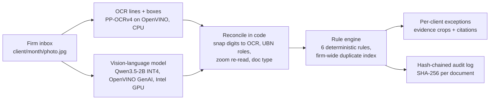

# Ledger Room

An on-premises voucher audit station for Taiwanese bookkeeping firms (記帳業者). One shared machine in the office
reads every client's receipts and uniform invoices (統一發票), checks them with deterministic rules, and gives the
bookkeeper a per-client exception list with evidence crops, rule citations and a tamper-evident audit log.
The documents never leave the office network.

Entry for the ASUS UGen AI League (Thunderstorm track, Workplace AI). Work in progress; Stage I build.

> **All data in this repository is SYNTHETIC.** Every company, Unified Business Number (統一編號, UBN), invoice
> number, amount and document image is generated by code (`synth/generate.py`, drawn with Pillow). No real people,
> no real business records, no AI-generated images. Any match with a real business is coincidental.

## Why a bookkeeping firm needs this

- Taiwan has about 8,600 bookkeeping firms, and the Ministry of Finance inspects their personal-data safeguards
  every year (703 firms in 2025) ([news, 2025-11-26](https://www.ctee.com.tw/news/20251126701522-430104)).
- The safeguard regulation for bookkeepers requires supervising any outsourced processing (Art. 10), restricts and
  conditions international transfers of client data (Art. 11), and asks for usage records and system logs (Art. 19)
  ([regulation](https://law.moj.gov.tw/LawClass/LawAll.aspx?pcode=G0340165)). Sending client receipts to an
  overseas cloud model is exactly the kind of transfer that needs that paperwork. A local model avoids it.
- The UBN check-digit rule changed in 2023 (divisible by 10 became divisible by 5), so older checking code wrongly
  rejects newly issued numbers ([MOF Fiscal Information Agency](https://www.fia.gov.tw/singlehtml/3?cntId=c4d9cff38c8642ef8872774ee9987283)).
- A firm sees all of its clients' vouchers. Only a firm-level system can notice the same receipt claimed by two
  different client companies.

## What it checks

The model only reads. Every decision below is made by code in `ledger_room/rules.py`, and each exception links to its source.

| Rule id | What it catches | Source |
|---|---|---|
| `UBN_CHECKSUM` | A seller or buyer UBN that fails the 2023 mod-5 rule (with the 7th-digit-is-7 case). Also explains when a number passes the new rule but would fail the old one. | [FIA notice](https://www.fia.gov.tw/singlehtml/3?cntId=c4d9cff38c8642ef8872774ee9987283) |
| `DUP_CROSS_MONTH` | The same voucher submitted again by the same client (same invoice number, or same seller + date + total) | [VAT Act Art. 51](https://law.moj.gov.tw/LawClass/LawSingle.aspx?pcode=G0340080&flno=51) |
| `DUP_CROSS_CLIENT` | The same voucher filed under two different clients | [Art. 51](https://law.moj.gov.tw/LawClass/LawSingle.aspx?pcode=G0340080&flno=51), [Art. 33](https://law.moj.gov.tw/LawClass/LawSingle.aspx?pcode=G0340080&flno=33) |
| `S19_NONDEDUCTIBLE` | Input tax claimed on entertainment or gifts, employee personal benefits, a passenger car for own use, or non-business items | [VAT Act Art. 19](https://law.moj.gov.tw/LawClass/LawSingle.aspx?pcode=G0340080&flno=19) |
| `OVER_LIMIT` | A document above the client's own expense policy (meal, taxi, lodging, approval threshold) | client policy in `clients.json` |
| `PERIOD_MISMATCH` | A date outside the two-month filing period, or an e-invoice period header that does not contain its own date | [Art. 35](https://law.moj.gov.tw/LawClass/LawSingle.aspx?pcode=G0340080&flno=35), [Enforcement Rules Art. 29](https://law.moj.gov.tw/LawClass/LawSingle.aspx?pcode=G0340081&flno=29) |

## How it works



1. **Read.** OCR finds text lines, exact digits and their positions. The vision-language model sees the photo plus the
   OCR lines and returns the document as JSON (type, invoice number, date, seller and buyer, UBNs, items, totals, notes).
2. **Reconcile (code).** Model digits are snapped to the printed OCR digits when they differ by at most two places.
   UBN roles come from the words around each number (賣方 / 買方 / 買受人 / the red seller stamp), so a model that copies
   the seller's number into the buyer field is overruled. When the buyer UBN is printed in boxes that OCR misses, code
   crops the area next to the label, enlarges it and reads it again. Every field keeps its provenance
   (`ocr-confirmed`, `snapped`, `ocr-zoom`, `model-only`, ...).
3. **Check (code).** The six rules run across the whole firm at once, which is what makes cross-client duplicates visible.
4. **Show and log.** The web app lists exceptions per client with the evidence crop, the field provenance and the
   official citation. Every read and every exception goes into an append-only JSONL log where each entry carries the
   SHA-256 of the previous one.

## Model and runtime

| Part | Choice | License |
|---|---|---|
| Vision-language model | [OpenVINO/Qwen3.5-2B-int4-ov](https://huggingface.co/OpenVINO/Qwen3.5-2B-int4-ov) (Intel's pre-converted INT4 build of Qwen3.5-2B) | Apache-2.0 |
| Model runtime | OpenVINO GenAI 2026.4 `VLMPipeline`, device `GPU` (Intel GPU), falls back to `CPU` | Apache-2.0 |
| OCR | PP-OCRv4 det/rec models from the `rapidocr-onnxruntime` wheel, executed by OpenVINO | Apache-2.0 |

Why this path: it runs on the laptop's Intel UHD iGPU today through the same OpenVINO GPU plugin that drives Intel Arc,
and it follows the toolchain of ASUS's own Arc Pro B70 sample (OpenVINO + Qwen3.5 vision models). The measured
alternatives are in the results block below.

**Intel Arc Pro B70 path (planned, not measured).** No B70 was used for any number in this repository.
On the B70 (32 GB) the same code is meant to run with `LEDGER_DEVICE=GPU` and a larger reader such as
`OpenVINO/Qwen3.5-9B-int4-ov` or the INT8 build, set with `LEDGER_MODEL_DIR`. The memory headroom is what lets one
office machine keep the reader resident while it works through a whole month of vouchers for dozens of clients.
Stage II will measure this on the organisers' Thunderstorm environment.

**Offline.** The only step that needs the internet is the one-time model download. At run time nothing is sent out:
OCR, the model and the rules run in-process, and the web app loads no external scripts, fonts or images. OpenVINO's
optional telemetry package is installed as a dependency, but it is only used by the `ovc` model-conversion tool,
which Ledger Room does not call.

## Quick start (Windows, Python 3.12)

```powershell
python -m venv .venv
.venv\Scripts\python -m pip install -r requirements.txt
.venv\Scripts\python -m ledger_room.get_model          # one-time, ~2.1 GB, to E:\models or %LEDGER_MODEL_DIR%
.venv\Scripts\python -m pytest -q                      # rules, frozen answer keys, result consistency
.venv\Scripts\python -m ledger_room.pipeline --set main   # batch audit of the synthetic firm inbox
.venv\Scripts\python -m web.server                     # http://127.0.0.1:8780
```

Environment variables: `LEDGER_MODEL_DIR` (model folder), `LEDGER_DEVICE` (`GPU` or `CPU`),
`LEDGER_OCR_DEVICE` (default `CPU`), `LEDGER_VLM_MAX_SIDE` (default 896 px).

## Synthetic data and evaluation

- `data/main`: 52 documents, 5 fictitious clients, layout family A. `data/heldout`: 47 documents, 5 other
  fictitious clients, layout family B (other fonts, column order, landscape receipts, rotation, uneven light).
  Both answer keys (`eval/expected_*.json`) were committed before any prompt or code tuning; tuning used `main` only.
- Planted issues per set: bad UBN checksums, re-submitted vouchers across months, one voucher under two clients,
  Art. 19 items, over-limit documents, wrong-period documents, plus clean documents. Some clean documents carry
  UBNs that pass the 2023 rule but fail the old one, to catch checkers that still use mod 10.
- `eval/run_eval.py` compares Ledger Room with a **pure-model baseline**: the same model, same photo, same OCR lines,
  with the rules, the client's policy and the filing period in the prompt, plus a running list of the documents it
  already reviewed (built from its own answers). No code checks.
- Controls: an **oracle** run (rules on the ground-truth fields, must be 100%) and a **positive control** (a clean
  batch, then the same batch with one planted change per issue type).
- Every number below is generated from `eval/results.json` by `python -m eval.report`; a test fails if they differ.

## Results

<!-- RESULTS:START (generated by eval/report.py from eval/results.json) -->
<!-- RESULTS:END -->

## Limits

- Synthetic documents only. Real phone photos, handwriting and faded thermal paper will be harder.
- The planted issue types were designed by the author. The held-out set changes seed, clients and layouts, not the
  definitions of the issues.
- Art. 19 categories are decided by an auditable keyword table first and by the model's suggested category only as a
  fallback (marked "medium" confidence). A real deployment needs the firm to review that table.
- Synthetic UBNs are random numbers that satisfy the checksum; they were not checked against the national business
  register.
- Laptop timings use an Intel UHD iGPU. B70 performance is a plan until it is measured.

## Licenses

Code: MIT (see `LICENSE`). Model weights: Apache-2.0 (Qwen3.5, converted by OpenVINO). OCR models and RapidOCR:
Apache-2.0. Synthetic images are rendered with Noto Sans/Serif TC (SIL OFL) and Windows system fonts (DFKai-SB,
MingLiU); the images contain rendered text only, not font files.
