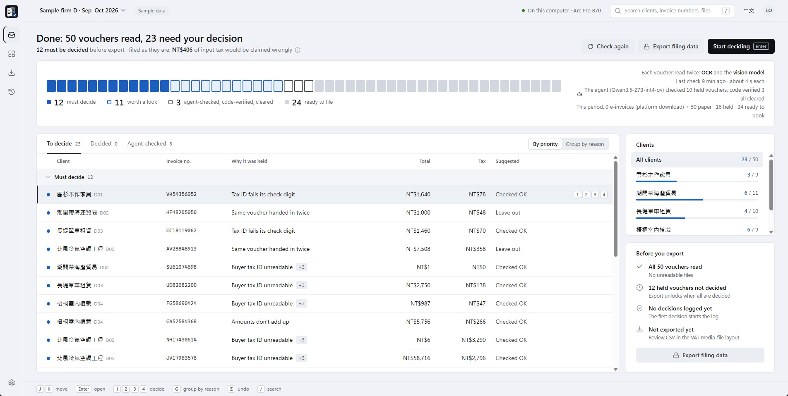
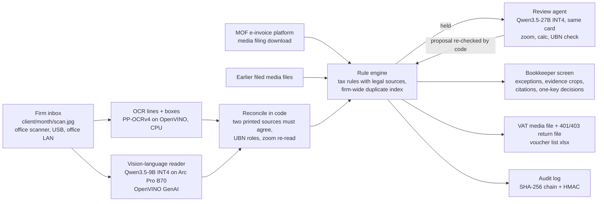

# Ledger Room

**Office software for Taiwanese bookkeeping firms (記帳業者) that checks every client voucher before the VAT return
is filed, on one machine inside the office.** A vision-language model on an Intel GPU reads the paper vouchers, code
checks them and the MOF e-invoice platform download against the tax rules, and a bookkeeper opens only the vouchers
still in doubt, each with its reason and legal source. Client data never leaves the office network.

*Live run on the organizers' Arc Pro B70 host, synthetic sample firm. Also: a held voucher with its reason, the law
it rests on, the evidence crops and one-key decisions ([second screenshot](docs/img/held_voucher_b70_host.png)).*

<!-- On submission day add as the first table row:  | Demo video | [YouTube](VIDEO_URL) |  -->
| Start here | |
|---|---|
| Slides | [docs/slides.pdf](docs/slides.pdf) |
| System architecture | [System architecture](#system-architecture) · [how it works, in detail](docs/how_it_works.md) |
| Model information | [Model information](#model-information) |
| Performance validation data | [Performance validation data](#performance-validation-data) · [every B70 run](docs/b70_measurements.md) |
| Run it | [Run it in five steps](#run-it-in-five-steps-windows-python-312) |

## Measured on the organizers' Intel Arc Pro B70

All numbers below were measured on the organizers' host (Intel Xeon 6787P, two Intel Arc Pro B70 cards, the same GPU
as the ASUS UGen B70, OpenVINO 2026.4.1). Each row names the results file it comes from; a test fails if the
documents and the files disagree.

| Result | Source |
|---|---|
| **113 real invoices of one company: its old ledger let 15 wrong rows through, Ledger Room let 0** (10 misread, all 10 held for a person) | `eval/results_real_company.json` → `old_ledger_vs_ledger_room` |
| **58 public real Taiwan photos, strict reading: 0 let through** (41 real_tw + 17 real_tw2, the latter a first run with its key frozen before any read) | `eval/results_real_tw_strict.json`, `eval/results_real_tw2_strict.json` |
| **Review agent, strict reading: 19 of 52 held vouchers cleared, 0 cleared wrong** (every proposal re-checked by code) | `eval/results_agent_b70_strict.json` → `summary` |
| **9B reader + 27B agent on one card: 21.8 GB with both reading, 23.0 GB peak in the agent run (strict reading), of 32 GB** | `eval/results_one_card.json`, `eval/results_agent_b70_strict.json` → `memory_gb.peak` |
| **3.6 s a voucher on one B70 vs 9.8 s on the host's two Xeon CPUs**, same code, same 12 documents | `eval/results_same_host_cpu_vs_b70_live.json` |
| **About 1,000 vouchers an hour a card; two cards for 70 minutes: 2,042 an hour, 0 restarts** | `eval/results_concurrency.json`, `eval/results_longrun_zoompad.json` |
| **194 W while reading, 187 Wh per 1,000 vouchers** (one card) | `eval/results_concurrency.json` → `rows[0].power` |
| **0 outside connections during a live batch** (47 documents read, 175.8 s watched) | `eval/results_offline_b70.json` |
| **The 401 filing pair passes the MOF offline checking program** (sample client) | `tests/fixtures/platform/mof_checked/`, [log](docs/stage2_log.md) |

### Performance on the Arc Pro B70

Seconds a voucher = OCR + model + post-processing for one document. Card memory from the Linux DRM fdinfo of the
reader processes. Energy = sampled card watts × read wall clock.

| Setup | Vouchers an hour | p50 | p95 | Card memory | Wh per 1,000 | Results file |
|---|---|---|---|---|---|---|
| One B70, one 9B reader, 47 held-out docs | 1,034 | 3.4 s | 4.1 s | 6.6 GB | 187 | `eval/results_concurrency.json` → `rows[0]` |
| Two B70s, one 9B reader each, 47 docs | 1,991 | 3.5 s | 4.4 s | 6.6 GB a card | 186 | `eval/results_concurrency_2cards.json` → `rows[0]` |
| Two B70s, 70 minutes, 2,383 docs, 0 restarts | 2,042 | 3.5 s | 4.5 s | 6.9 GB a card | 190 | `eval/results_longrun_zoompad.json` → `rows[0]` |
| One B70, 9B and 27B loaded together, 20 docs each | n/a | 3.9 s (9B) · 5.1 s (27B), mean | n/a | 21.8 GB | n/a | `eval/results_one_card.json` |
| Same host: two Xeon 6787P CPUs vs one B70, 12 docs | 367 vs 1,000 | 9.1 s vs 3.6 s | n/a | n/a | n/a | `eval/results_same_host_cpu_vs_b70_live.json` |

Every run, the held-out set and the real data in detail: [docs/b70_measurements.md](docs/b70_measurements.md),
[docs/real_data.md](docs/real_data.md).

## System architecture

1. **Read.** OCR finds text lines, digits and their positions; the 9B reader sees the photo plus the OCR lines and
   returns the document as JSON.
2. **Reconcile (code).** Model digits are snapped to the printed OCR digits, UBN roles come from the words around each
   number, and the total, net and tax are picked by code from the printed rows. In strict reading (the shipping mode)
   a value that goes into the filing needs two agreeing sources; otherwise the voucher goes to a person.
3. **Check (code).** The rules run across the whole firm at once, which is what makes cross-client duplicates visible.
   E-invoices come from the platform download, not from photos.
4. **Second look.** For held vouchers the 27B agent zooms, re-reads and calculates, and proposes values with evidence.
   Code accepts a value only with evidence from outside the model; the rules then run again.
5. **Decide, export, log.** The bookkeeper decides what is still held. Ledger Room writes the VAT media filing file,
   the 401/403 return data file and a voucher list, and every read, check and decision goes into a signed audit log.

"AI checks, code verifies, a person signs." Details of each step, the routing rules and the agent:
[docs/how_it_works.md](docs/how_it_works.md).

## Why a bookkeeping firm needs this

- Taiwan has about 8,600 bookkeeping firms, and the Ministry of Finance inspects their personal-data safeguards
  every year (703 firms in 2025) ([news, 2025-11-26](https://www.ctee.com.tw/news/20251126701522-430104)).
- The bookkeepers' personal-data safeguard regulation
  ([記帳士與記帳及報稅代理人個人資料檔案安全維護管理辦法](https://law.moj.gov.tw/LawClass/LawAll.aspx?pcode=G0340165))
  asks a firm to supervise outsourced processing (Art. 10), to check MOF restrictions and tell clients before any
  international transfer (Art. 11), to give staff different permissions (Art. 15), and to keep usage records and
  system trail data for at least five years (Art. 19 of this regulation, not the VAT Act's Art. 19). A firm whose systems hold 10,000 or more personal-data records
  must also have user identity checks, display masking, access control and monitoring of abnormal use (Art. 17).
  Sending client receipts to an overseas cloud model is exactly the kind of transfer that needs that paperwork. A
  local model avoids it, and the controls below map to this regulation's Arts. 15, 17 and 19.
- The UBN check-digit rule changed in 2023 (divisible by 10 became divisible by 5), so older checking code wrongly
  rejects newly issued numbers ([MOF Fiscal Information Agency](https://www.fia.gov.tw/singlehtml/3?cntId=c4d9cff38c8642ef8872774ee9987283)).
- A firm sees all of its clients' vouchers. Only a firm-level system can notice the same receipt claimed by two
  different client companies.

## Who buys it

Bookkeeping and CPA firms that file VAT for many clients. They buy it to catch wrong claims before the tax office does.

| | |
|---|---|
| **The need** | 85,288 VAT violation cases in Taiwan in 2025; 25,600 were fined, NT$3.5 billion in total (MOF Fiscal Statistics Yearbook 2025, Table 3-29). A claim corrected before filing draws no fine (Tax Collection Act Art. 48-1). |
| **Example** | A NT$6,000 non-deductible input-tax claim found first by the tax office draws a NT$6,000 fine (MOF penalty reference table, 1×); a duplicate claim draws 0.5× the tax. Two catches like that a year pay a 50-client firm's licence. |
| **Price** | One office box built from ASUS parts with an ASUS UGen B70 card, NT$91,501–99,245 (ASUS parts NT$66,451–74,195 of it at Taiwan retail), plus NT$20 per client a month, at least 50 clients (NT$12,000 a year). |
| **Market** | About 8,600 bookkeeping firms and 2,435 CPA firms in Taiwan; first the roughly 320 large ones. |
| **Route** | An on-premises bundle on ASUS EXPERTHUB, whose four finance apps do not serve firms that file for many clients. |

Staff also key less: every voucher arrives already read, and they open only the held ones (53 of 113 on a real
company's invoices). Every number and its source: [slides](docs/slides.pdf), slide 9 and appendix A7.

## What it checks

The model only reads. Every decision below is made by code in `ledger_room/rules.py`, and each exception links to its source.

| Rule id | What it catches | Source |
|---|---|---|
| `UBN_CHECKSUM` | A seller or buyer UBN that fails the 2023 mod-5 rule (with the 7th-digit-is-7 case). Also explains when a number passes the new rule but would fail the old one. | [FIA notice](https://www.fia.gov.tw/singlehtml/3?cntId=c4d9cff38c8642ef8872774ee9987283) |
| `DUP_CROSS_MONTH` | The same voucher submitted again by the same client (same invoice number, or same seller + date + total) | With input tax for this client: deducting it twice may constitute over-claimed input tax (虛報進項稅額), [VAT Act Art. 51(1)(5)](https://law.moj.gov.tw/LawClass/LawSingle.aspx?pcode=G0340080&flno=51); the bookkeeper decides. Without (e.g. a taxi receipt): [Income Tax Act Art. 24](https://law.moj.gov.tw/LawClass/LawSingle.aspx?pcode=G0340003&flno=24) and [Audit Regulations Art. 67(1)](https://law.moj.gov.tw/LawClass/LawSingle.aspx?pcode=G0340051&flno=67) (an expense without an original voucher is in principle not recognised) |
| `DUP_CROSS_CLIENT` | The same voucher filed under two different clients. The period check extends it to e-invoices: an invoice on one client's platform download (the platform names the buyer) that turns up in another client's paper, or on two clients' downloads | As above, plus [VAT Act Art. 33](https://law.moj.gov.tw/LawClass/LawSingle.aspx?pcode=G0340080&flno=33) when input tax is claimed |
| `S19_NONDEDUCTIBLE` | Input tax claimed on entertainment or gifts, employee personal benefits, a passenger car for own use, or non-business items | [VAT Act Art. 19](https://law.moj.gov.tw/LawClass/LawSingle.aspx?pcode=G0340080&flno=19) |
| `OVER_LIMIT` | A document above the client's own expense policy (meal, taxi, lodging, approval threshold) | client policy in `clients.json` |
| `PERIOD_MISMATCH` | A date after the filing period (VAT is filed per two-month period, by the 15th of the next odd month: September–October by 15 November), or an e-invoice period header that does not contain its own date. A date **before** the period is only a warning: input tax may be claimed in a later period (from the second period on, with a stated reason, up to ten years) | [Art. 35](https://law.moj.gov.tw/LawClass/LawSingle.aspx?pcode=G0340080&flno=35), [Enforcement Rules Art. 29](https://law.moj.gov.tw/LawClass/LawSingle.aspx?pcode=G0340081&flno=29) |

Severities: a match on seller + date + amount without a shared invoice number is a **possible duplicate** (warning:
two same-day taxi rides at the same fare are normal); a shared invoice number is a duplicate (high). VAT Act Art. 19 matches on
alcohol and meal words are **to confirm** (warning: a restaurant buys beer to resell); gifts, staff trips and passenger
cars stay findings. Twelve routing rules (amounts that do not add up, buyer not the client, voided or already-filed
e-invoices, utility bills, customs certificates and more) are listed in
[docs/how_it_works.md](docs/how_it_works.md#routing-rules).

## Access control and the audit log

- **Binds to 127.0.0.1.** Without user accounts the web app is a single local user and refuses any other address.
- **Accounts and roles** (regulation Arts. 15 and 17(1)(1)): `python -m web.users add NAME --role admin|staff` stores
  PBKDF2-SHA256 password hashes in `%LOCALAPPDATA%\LedgerRoom\users.json`. With accounts, every request except the
  sign-in page needs a session (8 hours, HttpOnly, SameSite=Strict); five wrong passwords lock that name for five
  minutes. Staff can read exceptions and documents, decide held vouchers and export; only an admin can run the model and
  read the logs. Only then may `--host 0.0.0.0 --cert cert.pem --key key.pem` share it on the office LAN over HTTPS
  (or `--host 0.0.0.0 --behind-tls-proxy` when an HTTPS reverse proxy sits in front); it refuses plain HTTP off loopback.
- **Operation log** (regulation Arts. 17(1)(4), 17(1)(6) and 19): sign-ins, failed sign-ins, runs, result views, log views and
  exports are appended to `data/out/oplog.jsonl` with the user and IP address.
- **Tamper evidence.** Each log entry carries the SHA-256 of the previous entry and an HMAC-SHA256 under an operator
  key (`%LOCALAPPDATA%\LedgerRoom\audit.key`, created on first use, outside the data folder). Whoever holds the key can
  detect an edited, inserted or removed entry (`tests/test_audit_log.py` forges a re-chained log and the HMAC catches
  it). For real use the key belongs on a separate USB key or Windows account (`LEDGER_AUDIT_KEY_FILE`).
- **Display masking** (regulation Art. 17(1)(2)): names that read as a person's, phone and ID numbers and e-mail
  addresses are masked by default in the web app, the CSV export and the log views. Only an admin can unmask, with a
  reason, and each unmask goes into the operation log (`ledger_room/privacy.py`, [docs/data_handling.md](docs/data_handling.md)).
- **Contract end** (regulation Art. 19): `python -m ledger_room.privacy purge` deletes a client's working copies, keeps
  the logs and writes a deletion record to the operation log.
- **Encryption at rest:** Ledger Room relies on the disk's full-disk encryption (BitLocker, LUKS, FileVault) and warns
  at start-up when the data folder is not on an encrypted volume. Ledger Room never deletes logs; retention is the
  firm's backup policy.
- **Security review, 2026-11-07:** an automated security scan of `web/` and `ledger_room/` found 9 issues (0 critical,
  0 high, 7 medium, 2 low). All 9 are fixed, together with 8 fixes from a code review (878f798).

## Model information

| Part | Model | Format and runtime | Size on disk | Card memory on the B70 | License |
|---|---|---|---|---|---|
| Reader (every voucher) | Qwen3.5-9B, [OpenVINO/Qwen3.5-9B-int4-ov](https://huggingface.co/OpenVINO/Qwen3.5-9B-int4-ov) | INT4 weights, OpenVINO GenAI 2026.4.1 `VLMPipeline`, thinking mode off | 5.85 GB | 6.6 GB reading (7.99 GB peak in the held-out bench) | Apache-2.0 |
| Review agent (held vouchers only) | Qwen3.5-27B, [OpenVINO/Qwen3.5-27B-int4-ov](https://huggingface.co/OpenVINO/Qwen3.5-27B-int4-ov) | INT4, OpenVINO GenAI 2026.4.1, temperature 0 | 14.87 GB | 17.04 GB alone; 9B + 27B together 21.8 GB, 23.0 GB peak (agent run, strict reading) | Apache-2.0 |
| Reader on a laptop (Lite) | Qwen3.5-2B, [OpenVINO/Qwen3.5-2B-int4-ov](https://huggingface.co/OpenVINO/Qwen3.5-2B-int4-ov) | INT4, OpenVINO GenAI, Intel iGPU | 1.99 GB | 3.9 GB peak RAM on the laptop iGPU | Apache-2.0 |
| OCR | PP-OCRv4 det/rec from the `rapidocr-onnxruntime` 1.4.4 wheel | ONNX models compiled and run by OpenVINO 2026.4.1, CPU | bundled in the wheel | none (CPU) | Apache-2.0 |

- All three vision-language models are Intel's pre-converted INT4 builds on Hugging Face; Ledger Room does not
  fine-tune them. `python -m ledger_room.get_model --repo ... --dir ...` downloads them once; after that nothing needs
  the internet. Exact package versions: [requirements.txt](requirements.txt).
- Devices: `LEDGER_DEVICE=GPU.0` for the reader, `LEDGER_AGENT_DEVICE` for the agent (same card by default),
  `LEDGER_OCR_DEVICE=CPU`; images go to the model at a long side of at most 896 px (`LEDGER_VLM_MAX_SIDE`).
- Sources of the memory figures: `eval/results_concurrency.json` (fdinfo per reader), `eval/results_b70.json` →
  `results[...].peak_memory`, `eval/results_one_card.json`, `eval/results_agent_b70_strict.json`, `eval/reader_memory.json`.
- Why 9B on the B70 and not the 2B: on the same 113 real invoices the 2B sends 91 to a person and lets 1 through, the 9B
  sends 53 and lets 0 through; on the 336-voucher real box 36.1% against 21.5% of fields wrong
  ([details](docs/b70_measurements.md#headline-results-in-detail)). Runtime choices and the Stage II targets set before
  the B70 runs: [docs/evaluation.md](docs/evaluation.md#model-choice-and-stage-ii-targets).

## Performance validation data

Every reported number has a committed results file in `eval/`. Synthetic sets are generated by code; real sets are
aggregates only (no images or values from private documents are in this repository).

| What | Results file | Reproduce |
|---|---|---|
| Held-out set (47 docs), 9B and 27B, Ledger Room vs the same model auditing alone: F1 1.00 vs 0.20, 0/319 key fields wrong | `eval/results_b70.json` | `python -m eval.bench_b70` |
| Throughput, latency, memory, power: 1 to 4 readers per card, one and two cards | `eval/results_concurrency.json`, `eval/results_concurrency_2cards.json` | `python -m eval.bench_concurrency` |
| 70-minute two-card run and compute-engine busy share | `eval/results_longrun_zoompad.json`, `eval/results_longrun_zoompad_util.json` | `python -m eval.bench_concurrency --duration-min 70`, `eval/util_sampler.py` |
| Same host CPU vs B70 | `eval/results_same_host_cpu_vs_b70_live.json` | `python -m eval.bench_cpu_vs_b70 --devices CPU,GPU.1` |
| 9B + 27B on one card | `eval/results_one_card.json` | `python -m eval.bench_one_card` |
| Review agent (default reading; strict reading) | `eval/results_agent_b70.json`, `eval/results_agent_b70_strict.json` | `python -m eval.agent_eval [--strict]` |
| Unseen layouts (blind3, first run), hard set, tiered reading | `eval/results_tiered.json`, `eval/results_hard.json`, `eval/results_after_fix_r9*.json` | `python -m eval.bench_tiered`, `eval.hard_eval` |
| Real photos (real_tw, real_tw2) and real receipts (CORD v2) | `eval/results_real_tw*.json`, `eval/results_real_intl_cord_b70.json` | `python -m eval.real_photo_eval`, `eval.strict_rescore` |
| Real company: 336 vouchers, 113 invoices against the old ledger | `eval/results_real_company.json`, `eval/results_utility_detect.json` | aggregates only ([data rule](docs/real_data.md)) |
| Offline: network watch during a live batch | `eval/results_offline_b70.json`, `eval/results_offline.json` | `python -m eval.offline_check` |
| Period check: e-invoices and paper together (synthetic firm period, 18 of 18 planted errors caught) | `eval/results_period_check.json` | `python -m eval.period_check --synthetic` |
| Laptop (Stage I) results, controls, OCR-only comparison | `eval/results.json`, [eval/RESULTS.md](eval/RESULTS.md) | `python -m eval.run_eval`, `eval.report` |

- Exact commands, the keys to compare and run times: [docs/b70_measurements.md](docs/b70_measurements.md#reproduce-on-the-b70-host)
  (B70 host, `bash scripts/setup_host.sh` first) and [docs/evaluation.md](docs/evaluation.md#reproduce-the-evaluation)
  (laptop).
- Answer keys (`eval/expected_*.json`) and their hashes (`eval/frozen_*.json`) were committed before the runs they
  score. Test sets and how they were built: [docs/new_sets.md](docs/new_sets.md), [docs/real_photos.md](docs/real_photos.md),
  [docs/blind3.md](docs/blind3.md); reading modes: [docs/strict.md](docs/strict.md), [docs/tiered.md](docs/tiered.md);
  agent rules: [docs/agent.md](docs/agent.md).
- `pytest` checks that the numbers quoted in this README and in `docs/` equal the results files.

## Run it in five steps (Windows, Python 3.12)

1. **Install.** `python -m venv .venv` then `.venv\Scripts\python -m pip install -r requirements.txt`
2. **Download the model once** (about 2.1 GB, the only step that needs the internet):
   `.venv\Scripts\python -m ledger_room.get_model`
   It fetches [OpenVINO/Qwen3.5-2B-int4-ov](https://huggingface.co/OpenVINO/Qwen3.5-2B-int4-ov) into
   `E:\models\Qwen3.5-2B-int4-ov`. For another folder, set `LEDGER_MODEL_DIR` first, for example
   `$env:LEDGER_MODEL_DIR="C:\models\Qwen3.5-2B-int4-ov"` in PowerShell. On a B70, download
   `--repo OpenVINO/Qwen3.5-9B-int4-ov --dir E:\models\Qwen3.5-9B-int4-ov` the same way and point `LEDGER_MODEL_DIR` at it.
3. **Test.** `.venv\Scripts\python -m pytest -q` checks the rule engine, the UBN checksum, the frozen answer keys and
   that every number quoted in this README and in `docs/` equals its results file. No model needed.
4. **Audit offline.** Turn off Wi-Fi or unplug the cable, then
   `.venv\Scripts\python -m ledger_room.pipeline --set heldout`
   This reads all 47 held-out documents with the model and writes `data/out/runs/<run id>/` with `result.json`,
   evidence crops and `audit_log.jsonl`. Reads are cached in `data/out/cache`, so a second run with `--cache-only`
   replays them in seconds without loading the model. `--set main` runs the other inbox.
5. **Open the web app.** `.venv\Scripts\python -m web.server`, then browse to http://127.0.0.1:8780. The page is in
   Traditional Chinese; the button at the top right switches to English. A bar of four steps says what to do next:
   1. **Add vouchers**: the inbox (`data/<inbox>/clients/<client>/<YYYY-MM>/*.jpg|png`) shows how many it holds.
   2. **Check this period**: reads every voucher with the model, then runs the rules. Progress is saved after every
      voucher; after a restart the page offers to continue without reading the finished vouchers again.
   3. **Decide the held ones**: each held voucher shows the reason, the evidence crop and the rule, with four decisions
      (checked OK, not deductible, leave out, next period) and a suggestion where the rule makes one. Decisions are
      saved at once to `review.jsonl`, hash-chained and signed like the audit log. Keys: J / K, 1 to 4, Enter, U.
   4. **Export the filing data**: enabled once every held voucher is decided.

   The app reads strictly by default (a filing value needs two agreeing sources). "Sample firm D" (`data/demo`, 50
   vouchers) is the synthetic demo inbox in the screenshots; every UBN on it was checked against the FIA
   business-registration API and is unregistered (`data/demo/ubn_check.json`). With a 27B model present the review
   agent runs on held vouchers by itself; `LEDGER_AGENT=0` turns it off. No Intel GPU? Set `LEDGER_DEVICE=CPU`.

## Data

> **The test sets in this repository are SYNTHETIC unless named otherwise.** Every company, Unified Business Number
> (統一編號, UBN), invoice number, amount and document image in `data/` is generated by code (`synth/generate.py`,
> drawn with Pillow). No real people, no real business records, no AI-generated images. Any match with a real
> business is coincidental.

Real data, named wherever it is used: 41 + 17 public Taiwanese receipt photos from Wikimedia Commons (CC BY-SA,
attribution in `data/real_tw/ATTRIBUTION.md`), 193 receipts of the public CORD v2 dataset (CC BY 4.0), and one small
company's petty-cash box of 336 vouchers, shared by its owner for this test, published as aggregate counts only
([data rule](docs/real_data.md)). Intake, masking, encryption and contract end: [docs/data_handling.md](docs/data_handling.md).

## Scope and roadmap

| Area | Done and measured | Next |
|---|---|---|
| Reading | 9B on the B70 with strict reading: 0 let through on 113 real invoices and on 58 public photos | A pilot firm's client folders, with answer keys checked by a licensed bookkeeper |
| Throughput | About 1,000 vouchers an hour a card; 70 minutes on two cards with 0 restarts | An overnight batch; batching inside one reader |
| Review agent | 19 of 52 held vouchers cleared on the B70, 0 wrong | History and platform tools on a real firm's data |
| Filing | VAT media file and 401/403 return data file; the 401 pair passes the MOF offline checker | Form 403 through the checker; a real client's period |
| E-invoice platform | Reads the platform's media filing download layout; period check across e-invoices and paper | A real platform download with the client's authorisation |
| Accounting software | Voucher list (.xlsx / CSV, 13 columns) | Import mapping for 正航, 鼎新 A1 and 文中 |
| Scanning | Page splitter for several vouchers on one A4 scan (`ledger_room/split.py`) | Connect it to the pipeline |

Method notes for every test set: [docs/evaluation.md](docs/evaluation.md#test-coverage-notes). Development log:
[docs/stage2_log.md](docs/stage2_log.md).

## Licenses

Code: MIT (see `LICENSE`). Model weights: Apache-2.0 (Qwen3.5, converted by OpenVINO). OCR models and RapidOCR:
Apache-2.0. Synthetic images are rendered with Noto Sans/Serif TC (SIL OFL) and Windows system fonts (DFKai-SB,
MingLiU); the images contain rendered text only, not font files.
