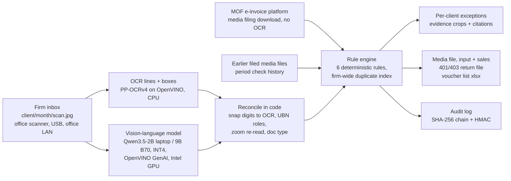

# How it works, in detail

## In short

**How it works, in short.** The firm scans each client's paper
vouchers into `client/month/` folders on one office machine (office scanner, USB stick or the office LAN; see
[data_handling.md](data_handling.md)) and adds the client's media filing download from the MOF e-invoice
platform, so e-invoices are imported, not photographed. OCR and a vision-language model
on OpenVINO (Qwen3.5-2B INT4 on the laptop iGPU in Stage I, Qwen3.5-9B INT4 on an Intel Arc Pro B70 in Stage II) read
every document. Deterministic code then checks Unified Business Number
(統一編號, UBN) checksums under the 2023 rule, duplicates within a client and across clients, VAT Act Art. 19
non-deductible items, client expense limits and filing periods. The bookkeeper gets a per-client exception list with
evidence crops and law citations, the client's full VAT media filing file (input and sales lines) and return data file
for forms 401 and 403 (the 401 pair passes the MOF offline checking program on synthetic data), a voucher list to import into accounting
software, and an HMAC-chained audit log, and nothing leaves the office network. On the held-out synthetic set, first blind run on the laptop (2B reader), Ledger Room scored micro F1 0.96;
the same model auditing on its own scored 0.15, and OCR with the same rules scores as well as Ledger Room on that clean
synthetic print (details under [Results](evaluation.md#results)). The real-photo first runs, their strict re-score and the
caveats on every set are under [b70_measurements.md](b70_measurements.md).

## How it works

1. **Read.** OCR finds text lines, exact digits and their positions. The vision-language model sees the photo plus the
   OCR lines and returns the document as JSON (type, invoice number, date, seller and buyer, UBNs, items, totals, notes).
2. **Reconcile (code).** Model digits are snapped to the printed OCR digits when they differ by at most two places.
   UBN roles come from the words around each number (賣方 / 買方 / 買受人 / the red seller stamp), so a model that copies
   the seller's number into the buyer field is overruled. When the buyer UBN is printed in boxes that OCR misses, code
   crops the area next to the label, enlarges it and reads it again. The total, net and tax are picked by code from
   the printed rows (cash, change, balance and deposit lines never count); the model's own reading is one vote, and a
   total without two agreeing sources goes to a person. Every field keeps its provenance
   (`ocr-confirmed`, `snapped`, `ocr-zoom`, `model-only`, ...).
3. **Check (code).** The six rules run across the whole firm at once, which is what makes cross-client duplicates visible.
4. **Show, export and log.** The web app lists exceptions per client with the evidence crop, the field provenance and
   the official citation. Each run also writes `export_media.csv`: one line per document, laid out like the input records of the VAT media
   filing file (進項媒體申報檔), with the format code (格式代號 21 / 22 / 25 / 28), the deduction code (扣抵代號 1, or 3 when VAT Act Art. 19 applies; 2 and 4 for fixed assets are
   set by hand), the ROC date and a status (`READY`, shown as pre-checked because a bookkeeper still signs off every
   line; `HOLD` until an exception is resolved; or `NOT_IN_FILE` for a voucher without input tax or one already in the
   platform download). `ledger_room/filing.py` builds the client's filing files from the pre-checked lines and the
   platform download, and `ledger_room/voucher_export.py` writes the voucher list for accounting software (see
   [stage2_log.md](stage2_log.md)); the 401 pair passes the MOF offline checking program on a synthetic client, and
   nothing has been imported into accounting software yet. Every read and every exception goes into an append-only
   JSONL log (see [Access control and the audit log](../README.md#access-control-and-the-audit-log)).
5. **E-invoices without OCR.** Most input vouchers already exist on the MOF e-invoice platform, and a bookkeeper the
   client has authorised can download them. `ledger_room/einvoice_platform.py` reads the platform's media filing
   download (one `<UBN>.txt` per client, 81-character records, input and sales lines) from `data/platform/<client UBN>/`,
   and the web app loads it for every run. A photographed invoice already in it is not entered again (`IN_PLATFORM`);
   one the platform marks voided is held (`VOID_ON_PLATFORM`) and never filed. The download carries no item names, so
   the VAT Act Art. 19 keyword check runs on platform lines only when a carrier export with item names sits next to
   the download (step 6). The reader follows the layout shown in the platform
   manual; no real download has been parsed yet (that needs the client's login). Photos are for paper vouchers the
   platform does not have. Separately, `ledger_room/einvoice.py` imports a consumer's e-invoice CSV export (UTF-8 or
   Big5, footnote lines skipped, line items grouped into invoices, discount and zero-price lines kept); it was run once
   on one person's own consumer e-invoices (aggregates under [Results](evaluation.md#results)).
6. **Period check: every voucher of the period, e-invoices and paper together.** Paper is the smaller part of a
   firm's input vouchers (about 15% of uniform invoices were paper in 2023), so the check that matters is the one
   before the return goes out. `ledger_room/period_check.py` takes, per client and period, the platform download, an
   optional carrier export with item names (`*.csv` next to the download), the media files the firm already filed
   for earlier periods (`data/filed/<client UBN>/`) and the paper run, and runs one set of checks across all of them:
   `DUP_PRIOR_FILING`, `PLATFORM_AMOUNT_DIFF`, `PLATFORM_RECORD_CONFLICT`, `DUP_CROSS_CLIENT` across platform lines
   and paper, VAT Act Art. 19 on platform lines that have item names, and `FIXED_ASSET_HINT` on platform lines of
   NT$80,000 or more. Each voucher ends as ready to book, held for a person, booked from its platform line (a photo of
   an invoice the platform already has), or left out (a voided platform line). The web app runs it with every batch
   and shows one line above the exceptions ("This period: N e-invoices (from the platform download) + M paper
   vouchers (read), K held for a person"); held e-invoices appear in the same list, marked as coming from the
   platform. Not checked, and said so in the report: Art. 19 on platform lines without item names (the media file
   has none), B2B exchange invoices the buyer has not confirmed (the media file has no such field), and whether a
   photographed e-invoice should be on the download (upload delays make an absence weak evidence). The `heldout`
   inbox has synthetic platform downloads and earlier filings (`synth/period_demo.py`) so the screen has something
   to show; the evaluation does not load them. Each client also gets a tax-at-risk ranking ("Look at first" in the web
   app): held input tax that would be claimed wrongly (double claim, voided, non-deductible) first, then tax not yet
   confirmed. Two flags only set the order of work: over NT$2,000 wrongly claimed (Penalty Reduction Standard Art. 15,
   VAT Act Art. 51 cases) and held tax over 5% of the period's input tax (Art. 15 keying errors in a media-file filing;
   double claims and non-deductible items are not keying errors). Synthetic period: NT$5,582 would be claimed wrongly
   (10 vouchers), NT$2,733 is unconfirmed (3); 1 of 4 clients is over NT$2,000, 2 are over 5%.

Scans are working copies. The paper originals stay with the client and are kept at least five years (Art. 27 of the
regulation on account books and vouchers); Ledger Room does not replace paper. Documents should reach the box through
the office scanner, a USB stick or the office LAN. LINE or e-mail is a transfer through a third party's servers: if a
client insists on it, that is the client's choice, and the file is imported, then deleted
([data_handling.md](data_handling.md)).

## Routing rules

The six evaluated rules are in the [README](../README.md#what-it-checks). Routing rules, outside the six evaluated types (the answer keys were frozen before them), reported separately:

| Rule id | What it does | Source |
|---|---|---|
| `AMOUNT_MISMATCH` (hold) | net + tax must equal the total and tax must be 5% of net (NT$1 rounding); a voucher the client would deduct also needs both amounts read. Held until corrected. | arithmetic, 5% standard rate |
| `BUYER_NOT_CLIENT` | buyer UBN missing (consumer-style invoice: expense only) or another company's: no deductible input tax. A two-part invoice (二聯式) without the buyer's UBN is never deductible; a two-part cash-register invoice that carries this client's UBN is (format code 22, [Enforcement Rules Art. 38](https://law.moj.gov.tw/LawClass/LawSingle.aspx?pcode=G0340081&flno=38)) | [VAT Act Art. 19(1)(1)](https://law.moj.gov.tw/LawClass/LawSingle.aspx?pcode=G0340080&flno=19), [Art. 33](https://law.moj.gov.tw/LawClass/LawSingle.aspx?pcode=G0340080&flno=33) |
| `BUYER_PRESUMED` (hold) | buyer UBN unreadable but the buyer name looks like the client: never deducted on a guess | Art. 33 |
| `NOT_A_VOUCHER` (hold) | a payment slip or a transaction / order detail (printed keywords, traditional or simplified), or a slip with neither seller UBN nor invoice number: not a voucher on its own; ask the client for the invoice | [Audit Regulations Art. 67](https://law.moj.gov.tw/LawClass/LawSingle.aspx?pcode=G0340051&flno=67) |
| `IN_PLATFORM` (info) | a photographed invoice whose number is already in the client's e-invoice platform download for the period: not entered again (the platform line stands for it), so the same input tax is not claimed twice | [VAT Act Art. 51(1)(5)](https://law.moj.gov.tw/LawClass/LawSingle.aspx?pcode=G0340080&flno=51) |
| `VOID_ON_PLATFORM` (hold) | a photographed invoice the platform download marks voided: held, and never written to the filing file | [VAT Act Art. 51(1)(5)](https://law.moj.gov.tw/LawClass/LawSingle.aspx?pcode=G0340080&flno=51) |
| `DUP_PRIOR_FILING` (high, period check) | an invoice about to be claimed this period (a platform line, or a paper line that would be filed) whose number and seller UBN are already in a media file the client filed for an earlier period. Invoice tracks are reused across years, so the seller must match too; without a seller UBN the number alone decides | [VAT Act Art. 51(1)(5)](https://law.moj.gov.tw/LawClass/LawSingle.aspx?pcode=G0340080&flno=51), [Enforcement Rules Art. 29](https://law.moj.gov.tw/LawClass/LawSingle.aspx?pcode=G0340081&flno=29) |
| `PLATFORM_AMOUNT_DIFF` (hold, period check) | a photographed invoice whose number is on the client's own platform download (`IN_PLATFORM`) but whose total or seller UBN differs: the platform line is held until the paper and the seller are checked (skipped when the photo's total already went to a person) | [營業稅電子資料申報繳稅作業要點 第二十點, 附件五](https://law-out.mof.gov.tw/LawContent.aspx?id=GL009478), [Audit Regulations Art. 67(1)](https://law.moj.gov.tw/LawClass/LawSingle.aspx?pcode=G0340051&flno=67) |
| `PLATFORM_RECORD_CONFLICT` (hold, period check) | one invoice twice in the client's platform downloads with different amounts or sellers (identical re-downloads are merged): only one may be filed | [VAT Act Art. 51(1)(5)](https://law.moj.gov.tw/LawClass/LawSingle.aspx?pcode=G0340080&flno=51) |
| `CUSTOMS_KEY_BY_HAND` (hold) | a customs-collected VAT payment certificate (format code 28) is recognised from its printed words and always held: the bookkeeper keys the certificate number and tax by hand; Ledger Room does not read it into the filing file | [Enforcement Rules Art. 38(1)(2)](https://law.moj.gov.tw/LawClass/LawSingle.aspx?pcode=G0340081&flno=38) |
| `UTILITY_BILL_PLATFORM` (info) | an electricity, water, telecom or gas bill or payment notice, recognised from printed words: a utility's name and a bill marker (such as 繳費期限 or 應繳總金額), never on an e-invoice proof (證明聯). Not keyed and not sent to a person: its input tax comes from the utility's e-invoice in the platform download, and the bill is kept as proof of payment. The invoice number printed on it (an earlier period's e-invoice) is not used for duplicates, and the bill never becomes a line in the export, the filing file or the voucher list. With the platform download loaded, the message says whether a platform record has the same seller UBN and total | [VAT Act Art. 33](https://law.moj.gov.tw/LawClass/LawSingle.aspx?pcode=G0340080&flno=33), [Art. 51(1)(5)](https://law.moj.gov.tw/LawClass/LawSingle.aspx?pcode=G0340080&flno=51) |
| `SMALL_RECEIPT_CAP` (warning) | plain receipts (普通收據) from small businesses (printed 免用統一發票), cumulative per client, above 3% (千分之三十) of the year's manufacturing expenses plus operating expenses (`annual_manufacturing_expenses` + `annual_operating_expenses` in `clients.json`, ideally the amounts the tax office assesses); off unless both are set. Other receipts are not capped by this rule | [Audit Regulations Art. 67(3)](https://law.moj.gov.tw/LawClass/LawSingle.aspx?pcode=G0340051&flno=67) |

Deduction codes: the export sets 1 (deductible purchases and expenses) or 3 (non-deductible, VAT Act Art. 19). Codes 2
and 4 (fixed assets) are not set automatically: a `FIXED_ASSET_HINT` warning says why a line may be one (net of
NT$80,000 or more, or an equipment word), and the bookkeeper changes the code.

Optional, off in the evaluation: `UBN_NOT_REGISTERED` (warning). With a local copy of the MOF business-registration
open data ([data.gov.tw dataset 9400](https://data.gov.tw/dataset/9400), set `LEDGER_REGISTRY` to the .zip or .csv),
a checksum failure one digit away from a registered business is reported as a likely misread, and a well-formed
number that is not registered gets a warning. `ledger_room/registry.py`; tested on a small fixture only, not yet on
the downloaded file.

## Agent: a second look at held documents

"AI checks, code verifies, a person signs." When the rules hold a document because a reading is not trusted (an
invoice number read from one source only, amounts that do not add up, a buyer UBN that was presumed), a larger model
(Qwen3.5-27B int4, temperature 0) takes a second look with tools: zoom (crop, enlarge, OCR the crop), calc, UBN check
digit, the firm's history and the client's platform download. It proposes values with evidence. Code then checks every
proposal again (rule v3 in `ledger_room/agent.py`): an amount counts only if net + tax = total and the other two
numbers were confirmed on the first reading or printed on the page; an invoice number or UBN counts only if the code-run
OCR of the crop reads the same string, or the page OCR has it and the first reader said the same. The model's own word
counts for nothing. Then the rules run again: a document with nothing left to hold is marked `agent-verified` and does
not wait for a person; anything else goes to a person exactly as before.

On screen the overview gets a fourth part, "agent-checked, code-verified", and the four parts add up to the period.
The review panel has a "How it was checked" line that opens into what the AI looked at, what code verified (with a tick
or the refusal reason) and the outcome. A value the agent changed is shown like a value a person corrected (first
reading struck through) and tagged "agent · code-verified". A person can reject the agent's result with one button: the
document goes back to its first reading and its original reasons, and both the rejection and any restore are written to
the audit log, as is every agent check. The 27B and the 9B reader fit on one B70 card (peak 23.0 GB VRAM plus 15.2 GB GTT in the strict-reading agent run,
`eval/results_agent_b70_strict.json`; 22.4 GB VRAM plus 15.3 GB GTT in the default-reading run, `eval/results_agent_b70.json`). A machine without the 27B turns the agent off by itself and the status shows "agent not enabled on this machine";
`LEDGER_AGENT=0` turns it off, `LEDGER_AGENT_DEVICE=GPU.1` moves it to another card.

Measured on the Arc Pro B70 (GPU.1, `eval/results_agent_b70.json`, two runs, identical outcomes per document):

| | held for a person | cleared by agent + code | cleared with a wrong key field |
|---|---|---|---|
| hard + blind3 | 30 | 10 | 0 |
| blind3 alone | 12 | 6 | 0 |
| plain code rule, no model (net + tax = total) | 30 | 9 | 2 |

The agent made 35 proposals; 5 were wrong and code refused all 5. A held document takes 8.0 s on average, 18.0 s at
most. In the web app's strict mode on the demo inboxes the agent cleared 2 of 7 held documents (heldout2), 0 of 2
(heldout) and 8 of 12 (main); every one was an invoice number confirmed by the zoom OCR, nothing changed. On blind3 it
cleared 10 of 20, two of them by filling in a total from net + tax. On the recording inbox (Sample firm D, 50
vouchers, organizers' host, 11-09) it looked at 10 held documents in about two and a half minutes and cleared 3; while
it works, the check page shows "The agent is on the held vouchers: i of n".

What these numbers do not show:

- Verification rule v3 was written after looking at the hard set; blind3 was run after the rule was fixed and is the
  only check on documents it was not tuned on (12 documents). The 0 wrong is small-sample.
- 9 of the 10 cleared documents passed on arithmetic (net + tax = total). That is mostly code doing the work; the model's
  part is choosing to call the calculation and finding the numbers. This is not "the AI read the picture and solved it".
- The history and platform tools were never used on the synthetic sets (no firm history, no platform download there).
  Only a unit test checks that code accepts them as sources (`tests/test_agent.py`).
- The evaluation runs the rules as the experiment did (not strict, no platform, no register); the web app runs strict.
- All synthetic data. No real client document has been through the agent.
